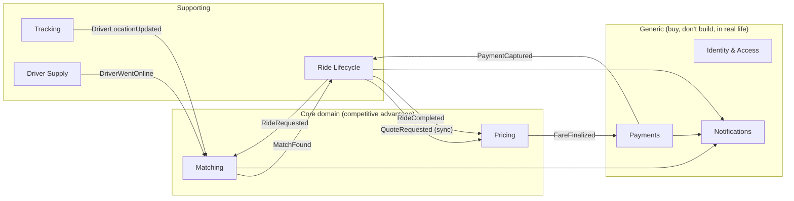
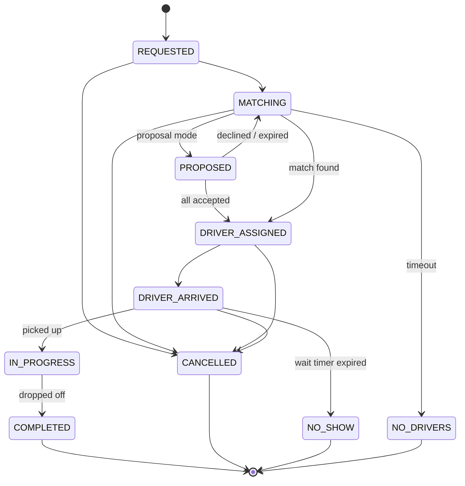

# 02 — Domain-Driven Design

> Covers prompt section 4. DDD here is not ceremony. Its job is to find the
> **consistency boundaries** of the system. Those boundaries later decide transaction
> scope, Kafka partition keys, and where the microservices split.

---

## 1. The key modeling decision: Ride ≠ Trip

The prompt lists both `Ride` and `SharedRide`. A naive model makes `SharedRide` a special
case of `Ride`, which gives you two code paths everywhere (dispatch, tracking, fare,
payment). That's the most common mistake in Pool clones.

**Decision:** separate the *rider's intent* from the *vehicle's journey*.

| Concept | Meaning | Owner |
|---|---|---|
| **Ride** | One rider's (or party's) journey from their pickup to their drop-off. It has its own price, its own state, and its own payment. | Rider |
| **Trip** | One driver's vehicle journey: an ordered list of **Stops** serving 1..N Rides. | Driver |

- A **solo** ride = a Trip with exactly one Ride.
- A **shared** ride = a Trip with 2+ Rides. That's what the prompt calls `SharedRide`.

This way dispatch, tracking, and driver navigation only ever deal with Trips and Stops,
and pricing and payments only ever deal with Rides. Pool becomes a property of a Trip
(`capacity > 1`, `allows_insertion = true`), not a separate subsystem.

That's essentially how Uber models it internally: a rider "job" vs. a driver "trip/plan"
with waypoints. Lyft's terminology is "ride" vs. "route".

---

## 2. Bounded Contexts



| Context | Responsibility | Why it's separate |
|---|---|---|
| **Identity & Access** | Users, credentials, tokens, roles | Security boundary; generic. |
| **Rider Profile** | Rider preferences, saved places, ratings | Low change rate. |
| **Driver Supply** | Drivers, vehicles, documents, online/offline state | Different lifecycle (onboarding, compliance). |
| **Tracking** | Location ingestion, latest position, ETA streaming | Very high write volume, eventually consistent. |
| **Ride Lifecycle** | Ride and Trip state machines, stops, cancellations | Owns the source of truth for "what is happening". |
| **Matching** | Candidate search, insertion, batching, proposals | CPU-heavy, region-sharded, experiment-heavy. |
| **Pricing** | Quotes, rate cards, surge, fare allocation, driver pay | Must be auditable and reproducible. |
| **Payments** | Authorization, capture, refunds, ledger | Strong consistency, compliance (PCI). |
| **Notifications** | Push, SMS, WebSocket fan-out | Pure side effects. |

**Context map relationships:**
- Matching → Ride Lifecycle: *customer/supplier*. Matching **proposes**, Ride Lifecycle **decides** (it owns seat-assignment consistency).
- Pricing → Ride Lifecycle: *open host service*. A sync `quote` API plus async `fare-calculated` events.
- Payments: *anti-corruption layer* around the external PSP (Razorpay/Stripe), so PSP models never leak into the domain.

---

## 3. Aggregates

An aggregate = a cluster of objects changed **atomically in one transaction**, with one root
that enforces its invariants. Rule of thumb: **one aggregate per transaction**. Anything
across aggregates is eventually consistent via domain events.

### 3.1 `Trip` aggregate (the most important one)

```
Trip (root)
 ├── id: TripId
 ├── driver_id: DriverId            (reference by id, not object)
 ├── vehicle_id: VehicleId
 ├── mode: SOLO | POOL
 ├── capacity: SeatCount
 ├── status: TripStatus
 ├── stops: list[Stop]              (entity, ordered)
 ├── ride_ids: set[RideId]
 ├── version: int                   (optimistic concurrency)
 └── methods:
     ├── insert_ride(ride, pickup_index, dropoff_index, constraints)
     ├── remove_ride(ride_id)       (cancellation → re-sequence stops)
     ├── arrive_at(stop_id)
     ├── complete_stop(stop_id)
     └── seats_occupied_at(stop_index) -> int
```

**Invariants enforced by Trip:**
1. At every point in the stop sequence, `seats_occupied ≤ capacity`.
2. Each ride's PICKUP stop comes before its DROPOFF stop.
3. No ride can be inserted unless `mode == POOL` and the trip isn't `COMPLETED`/`CANCELLED`.
4. Stops already `COMPLETED` can't be reordered (no time travel).
5. Detour constraint: an insertion must not push any onboard rider beyond their `max_arrival_time`. The matcher evaluates this, but the aggregate re-checks it, because the matcher's view may be stale.

**Why Trip and not Ride is the consistency boundary for seats:** two matchers inserting
riders concurrently must serialize on *the vehicle*. The `version` column gives you
optimistic locking: `UPDATE trips SET ... , version = version + 1 WHERE id = :id AND version = :v`.
If 0 rows are updated, the insertion lost the race and the matcher retries with a fresh plan.

### 3.2 `Ride` aggregate

```
Ride (root)
 ├── id: RideId
 ├── rider_id: RiderId
 ├── product: SOLO | POOL
 ├── seats: SeatCount (1..2)
 ├── pickup: GeoPoint, dropoff: GeoPoint
 ├── quote: FareQuote (value object, snapshot)
 ├── status: RideStatus
 ├── trip_id: TripId | None
 ├── max_pickup_time, max_arrival_time: Timestamp (service guarantees)
 └── methods: assign_to_trip(), mark_picked_up(), mark_dropped_off(), cancel(reason, actor)
```

State machine:



Implement transitions as an explicit table (`ALLOWED = {(FROM, TO), ...}`) and reject
anything else with a domain error. **Never** write `ride.status = X` outside the aggregate.

### 3.3 Other aggregates

| Aggregate | Root | Contains | Key invariants |
|---|---|---|---|
| `User` | User | Credentials, roles | Unique phone/email; password policy. |
| `Rider` | Rider | Saved places, preferences | One active ride at a time (enforced in DB too). |
| `Driver` | Driver | Documents, availability state | Can go online only if `APPROVED` and has an active vehicle. Can't be on 2 trips. |
| `Vehicle` | Vehicle | — | Seats ≥ 1; one active vehicle per driver. |
| `FareQuote` | FareQuote | Line items | Immutable; expires at `expires_at`. |
| `Fare` | Fare | FareLineItems | Immutable once `FINALIZED`; Σ line items = total; adjustments are new records, not edits. |
| `Payment` | Payment | Attempts | State: `PENDING → AUTHORIZED → CAPTURED / FAILED / REFUNDED`; idempotency key unique. |
| `MatchProposal` | MatchProposal | Participant responses | Expires at TTL; accepted only if *all* participants accept before expiry. |
| `RateCard` | RateCard | Per-product rates | Versioned; never mutated, only superseded. |

`LocationUpdate` is **not** an aggregate. It's a high-volume value/event stream. Treating each
GPS ping as a domain entity with a lifecycle would be a classic over-modeling mistake.

---

## 4. Entities vs. Value Objects

**Entities** have identity and a lifecycle: `User`, `Rider`, `Driver`, `Vehicle`, `Ride`,
`Trip`, `Stop`, `Payment`, `MatchProposal`, `Fare`.

**Value objects** are immutable and compared by value. Use frozen dataclasses or Pydantic models with `frozen=True`:

| Value object | Fields | Why it's a VO |
|---|---|---|
| `Money` | `amount_minor: int`, `currency: str` | Prevents float math; `Money + Money` checks currency. |
| `GeoPoint` | `lat`, `lng` (validated ranges) | Validation in one place. |
| `H3Cell` | `index: str`, `resolution` | Spatial bucketing key. |
| `Route` | `distance_m`, `duration_s`, `polyline`, `legs` | Snapshot from the routing engine; immutable. |
| `RouteSegment` | `from_stop`, `to_stop`, `distance_m`, `duration_s`, `onboard_ride_ids` | Basis of fair fare allocation. |
| `SeatCount` | `int` 1..8 | |
| `SurgeMultiplier` | `Decimal` 1.0..5.0, `cell`, `computed_at` | |
| `DetourBudget` | `max_extra_seconds`, `max_ratio` | |
| `FareLineItem` | `type`, `amount: Money`, `description` | |
| `TimeWindow` | `earliest`, `latest` | Pickup/arrival guarantees. |
| `IdempotencyKey` | `str` | |

```python
@dataclass(frozen=True, slots=True)
class Money:
    amount_minor: int          # paise
    currency: str = "INR"

    def __add__(self, other: "Money") -> "Money":
        if other.currency != self.currency:
            raise CurrencyMismatch(self.currency, other.currency)
        return Money(self.amount_minor + other.amount_minor, self.currency)

    def allocate(self, weights: Sequence[Decimal]) -> list["Money"]:
        """Split without losing a paisa (largest-remainder method)."""
        ...
```

`Money.allocate` is where every fare algorithm ends. It guarantees Σ parts == total,
which is the invariant auditors and property-based tests care about.

---

## 5. Domain Services

Logic that doesn't naturally belong to one aggregate:

| Service | Responsibility | Pure? |
|---|---|---|
| `FareQuoteService` | Rate card + route + surge → `FareQuote` per product | Pure given inputs (easy to test). |
| `FareAllocationService` | Trip segments + rides → per-ride fares (strategy pattern, doc 07) | Pure. |
| `DriverPayService` | Trip actuals → driver earnings | Pure. |
| `InsertionPlanner` | Given a Trip's stops and a new Ride, find the best feasible insertion (doc 06) | Pure given a travel-time oracle. |
| `MatchingService` | Orchestrates candidate search → planning → scoring → proposal | Application service (I/O). |
| `SurgeService` | Supply/demand per H3 cell → multiplier | Periodic job. |
| `EtaService` | Wraps the routing engine (OSRM) with caching | Infra adapter behind a port. |
| `CancellationPolicy` | (ride state, elapsed time, actor) → fee | Pure. |

Keep pricing, allocation, insertion planning, and cancellation policy **pure functions
over value objects**. That's where the hard bugs live, and pure code is where you can use
property-based tests (Hypothesis) to prove invariants like "Σ allocation == total" and
"no rider pays more than their solo price".

---

## 6. Domain Events

Past tense, immutable, carry ids plus the minimal facts consumers need.

| Event | Emitted by | When |
|---|---|---|
| `UserRegistered` | Identity | Account created |
| `DriverWentOnline` / `DriverWentOffline` | Driver Supply | Availability change |
| `DriverLocationUpdated` | Tracking | Each accepted GPS ping |
| `FareQuoted` | Pricing | Quote created (analytics) |
| `RideRequested` | Ride Lifecycle | Ride created |
| `MatchProposed` | Matching | Proposal mode: offer sent |
| `MatchProposalResponded` | Ride Lifecycle | Rider accepted/declined |
| `RideMatched` | Ride Lifecycle | Ride assigned to a trip (after Trip insertion committed) |
| `DriverOfferSent` / `DriverOfferAccepted` / `DriverOfferDeclined` | Ride Lifecycle | Dispatch handshake |
| `TripStopsChanged` | Ride Lifecycle | Insertion/removal re-sequenced stops |
| `RiderPickedUp` / `RiderDroppedOff` | Ride Lifecycle | Per-ride legs |
| `RideStarted` / `RideCompleted` / `RideCancelled` | Ride Lifecycle | |
| `TripCompleted` | Ride Lifecycle | Last stop done |
| `FareCalculated` | Pricing | Final per-ride fare |
| `PaymentAuthorized` / `PaymentCaptured` / `PaymentFailed` / `PaymentRefunded` | Payments | |
| `NotificationRequested` | Any | Something the user should be told |

**Domain event vs. integration event:** domain events are in-process, raised by
aggregates. Integration events are the published, versioned Kafka contracts (doc 09).
The outbox translates the first into the second. Keeping them separate lets you refactor
internals without breaking consumers.

---

## 7. Ubiquitous language (glossary)

| Term | Definition |
|---|---|
| **Quote** | A price offer with an expiry, bound to a route snapshot and rate card version. |
| **Ride** | One rider party's journey. Has its own fare and payment. |
| **Trip** | One driver's vehicle journey: an ordered list of stops. |
| **Stop** | A PICKUP or DROPOFF for a specific ride. |
| **Insertion** | Adding a ride's pickup + drop-off stops into an existing trip plan. |
| **Detour** | Extra time a rider experiences vs. their solo route. |
| **Match window** | Time the matcher waits to batch Pool requests before dispatching. |
| **Segment** | The stretch between two consecutive stops; has a fixed set of onboard riders. |
| **Solo-equivalent price** | What the rider would pay riding alone. The reference point for savings. |