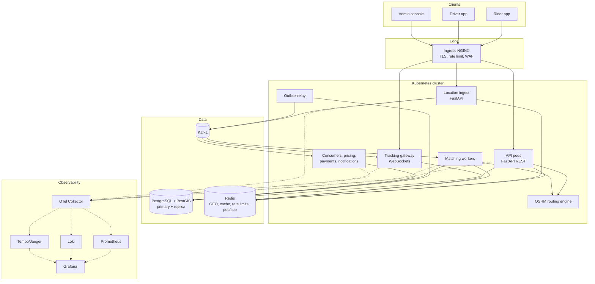

# 03 — Architecture: Modular Monolith → Microservices

> Covers prompt section 5 plus deliverables: high-level architecture, sequence diagrams,
> repository structure.

---

## 1. High-Level Architecture (target state)



**Reading the diagram, the key decisions are:**

1. **Location ingest is a separate deployment.** It's 10–100× the request volume of
   everything else and its data is disposable. It writes to Redis (hot index) and Kafka
   (history/analytics), and **never** blocks on Postgres.
2. **The API never publishes to Kafka directly.** It writes to an `outbox` table in the same
   transaction as the state change. A relay publishes. This prevents the "DB committed but
   event lost" dual-write bug (doc 17).
3. **Matching is asynchronous.** `POST /rides` returns `202 Accepted` with the ride in
   `MATCHING`. The client gets the result over WebSocket (or polls). This decouples API
   latency (< 200 ms) from match latency (< 2 s).
4. **The routing engine is a dependency, not a library.** OSRM runs as its own pod with a
   preprocessed OSM extract. Every ETA call is a network hop, so cache aggressively.

---

## 2. Phase 1 — Modular Monolith

### 2.1 Why start here

| Reason | Explanation |
|---|---|
| **You don't know the boundaries yet** | Splitting services along wrong boundaries is the most expensive mistake in distributed systems ("distributed monolith"). Refactoring module boundaries inside one repo is cheap. |
| **Transactions are free** | Ride + Trip + outbox in one ACID transaction. In microservices that becomes a saga. |
| **Operational load** | One deployable, one DB, one CI pipeline. As a solo developer, operational toil is your scarcest resource. |
| **Debuggability** | One stack trace instead of a distributed trace across 8 services. |
| **Industry practice** | Shopify (modular monolith at massive scale), Basecamp, GitHub, Stack Overflow. Uber itself started as a monolith (PHP, then Python "API" monolith) and paid heavily for its later 2,000+ microservice sprawl, which is why it published "Domain-Oriented Microservice Architecture" (DOMA) in 2020 to re-consolidate. |

**Advantages:** simple deploys, refactoring safety, easy local dev, consistent
transactions, one observability stack.

**Disadvantages:** you can't scale modules independently (mitigated below), one bad module
can crash the process, and you need discipline to keep boundaries clean (enforced with tooling).

### 2.2 Keeping a layered monolith honest

Decision (revised): **keep the existing layered scaffold** (`src/api`, `controller`,
`services`, `repositories`, `models`, `schemas`, `utils`). It's simpler to navigate, matches
`scripts/init.sh` (`src.app:app`) and the Dockerfile, and is fine for a monolith.

The cost of layers is that nothing stops features from reaching into each other, and a later
service extraction means pulling one feature out of seven folders. Two cheap habits recover
most of the benefit of modules:

1. **One file per feature inside each layer, with the same name across layers.**
   `api/rides.py`, `controller/rides.py`, `services/rides.py`, `repositories/rides.py`,
   `models/rides.py`, `schemas/rides.py`. A feature is then a *vertical slice by filename*,
   and extracting "tracking" later means moving `*/tracking.py`.
2. **Enforce the layer direction in CI** with
   [`import-linter`](https://import-linter.readthedocs.io/) (a `layers` contract, §2.4).
   This is the boundary that matters most: `services/` stays pure and unit-testable.
3. **Cross-feature rules (by convention, reviewed in PRs):**
   - A feature's `repositories/*.py` only touches that feature's tables (use a Postgres
     **schema per feature**: `rides.trips`, `pricing.fares`, ...).
   - Feature A calls feature B only through B's `controller` functions, never B's repository or model.
   - Side effects across features go through events (in-process first, Kafka via the outbox later).

### 2.3 What each layer means

```
src/
  api/            # FastAPI routers. Parse request, run auth dependency, call ONE controller function,
                  # map domain errors to problem+json. No business logic, no SQL.
  controller/     # Use-case orchestration: open the unit of work (DB transaction), load aggregates via
                  # repositories, call services, save, write outbox rows. One function per use case
                  # (request_ride, accept_offer, complete_stop). This is where transactions live.
  services/       # PURE business logic: fare engines, insertion planner, state machines, cancellation
                  # policy. Takes and returns plain objects. NO fastapi/sqlalchemy/redis/httpx imports.
  repositories/   # All SQL / PostGIS / Redis access. Returns models or plain objects.
  models/         # SQLAlchemy ORM models (and the Alembic target_metadata).
  schemas/        # Pydantic request/response DTOs and Money/GeoPoint value types.
  utils/          # Clock, ids (UUIDv7), geo helpers, settings.
  clients/        # NEW: adapters to the outside world (OSRM, Redis, Kafka, PSP). Behind small interfaces
                  # so tests can swap in fakes.
  workers/        # NEW: long-running entrypoints (matching worker, outbox relay, consumers).
  app.py          # FastAPI app factory (already referenced by scripts/init.sh)
```

Dependency direction: `api → controller → (services, repositories, clients) → models/schemas/utils`.
`services` may import only `schemas` and `utils`. The domain logic is framework-free, so it's
unit-testable in milliseconds; this is the part that matters, and layers give it to you as well as modules do.

### 2.4 Recommended repository structure

```
ride-share/
├── .github/workflows/          # pr.yml, main.yml, deploy.yml
├── deploy/
│   ├── k8s/{base,overlays/{dev,staging,prod}}/
│   ├── observability/          # prometheus rules, grafana dashboards (JSON), otel-collector
│   └── local/                  # compose files for kafka, redis, osrm, grafana stack
├── docs/{design,adr}/
├── contracts/{openapi,events}/
├── src/
│   ├── app.py
│   ├── api/                    # rides.py, trips.py, drivers.py, quotes.py, tracking.py, admin.py ...
│   ├── controller/             # same filenames
│   ├── services/               # same filenames (+ fare_engines/, matching/ sub-packages when they grow)
│   ├── repositories/
│   ├── models/
│   ├── schemas/
│   ├── clients/                # osrm.py, redis.py, kafka.py, psp.py
│   ├── workers/                # matching_worker.py, outbox_relay.py, consumers.py
│   ├── utils/
│   └── alembic/                # existing; versions/ holds migrations
├── tests/
│   ├── unit/                   # services/ and schemas/ (pure)
│   ├── integration/            # repositories + controller against real PostGIS/Redis/Kafka
│   ├── contract/
│   ├── e2e/
│   └── load/                   # locustfiles
├── scripts/
├── Dockerfile
├── docker-compose.yml
├── pyproject.toml
└── .importlinter
```

Example import-linter contract (a layers contract, replacing the per-module one):

```ini
[importlinter]
root_package = src

[importlinter:contract:layers]
name = Layer direction
type = layers
layers =
    src.api
    src.controller
    src.services | src.repositories | src.clients
    src.models | src.schemas
    src.utils

[importlinter:contract:services-pure]
name = Services have no framework or I/O imports
type = forbidden
source_modules = src.services
forbidden_modules = fastapi, sqlalchemy, redis, confluent_kafka, httpx, src.repositories, src.clients, src.models
```

### 2.5 "Scaling a monolith independently": one image, many deployments

The same Docker image runs with different commands:

| Deployment | Command | Scales on |
|---|---|---|
| `api` | `uvicorn src.app:app` | CPU / RPS |
| `location-ingest` | `uvicorn src.app_location:app` | RPS |
| `tracking-gateway` | `uvicorn src.app_tracking:app` | Connection count |
| `matching-worker` | `python -m src.workers.matching_worker` | Kafka lag (KEDA) |
| `outbox-relay` | `python -m src.workers.outbox_relay` | 1–2 replicas (leader-elected or SKIP LOCKED) |
| `consumers` | `python -m src.workers.consumers --group pricing,payments,notifications` | Kafka lag |

This gets you ~80% of microservices' operational benefits (independent scaling, failure
isolation per workload) at ~10% of the cost. It's the most valuable trick in this doc.

---

## 3. Phase 2 — Microservices

### 3.1 Target services

| Service | Owns (data) | Sync API | Publishes | Consumes | Store |
|---|---|---|---|---|---|
| **User** (Identity) | users, credentials, refresh_tokens, roles | auth, profile | `user-registered` | — | Postgres |
| **Driver** | drivers, vehicles, documents, availability | onboarding, online/offline | `driver-status-changed` | `ride-completed` (stats) | Postgres |
| **Tracking** | latest locations, history | location ingest, WS | `driver-location-updated` | `ride-matched`, `ride-completed` (who to stream to) | Redis + Timescale/Parquet |
| **Ride** | rides, trips, stops, proposals | request, cancel, state transitions | `ride-requested`, `ride-matched`, `ride-accepted`, `ride-started`, `ride-completed` | `match-found`, `fare-calculated`, `payment-*` | Postgres+PostGIS |
| **Matching** | ephemeral candidate state | internal only | `match-found`, `match-proposed` | `ride-requested`, `driver-location-updated`, `driver-status-changed` | Redis (state), no SoR |
| **Fare** (Pricing) | rate cards, quotes, fares, surge | `POST /quotes` | `fare-calculated` | `ride-completed`, `driver-location-updated` (surge) | Postgres |
| **Payment** | payments, ledger, PSP refs | payment methods | `payment-completed`, `payment-failed` | `fare-calculated` | Postgres (strict) |
| **Notification** | templates, delivery log | — | `notification-sent` | `notification-created`, many | Postgres/Redis |

Note **Matching has no system of record.** It *proposes*. The Ride service *commits*.
This keeps seat-consistency in one place and makes the matcher stateless and
restartable. That property matters most when you shard it by region.

### 3.2 Extraction order (strangler fig)

Extract in order of **(independent scaling need × boundary stability) / coupling**:

1. **Tracking** first: highest load, simplest contract (location in, events out), no transactions with others.
2. **Notifications**: pure consumer, zero risk.
3. **Matching**: CPU-bound, needs region sharding; already async via Kafka.
4. **Payments**: compliance isolation (PCI scope reduction), strict consistency.
5. **Pricing**: once the quote API is stable.
6. **Ride / Driver / User** last. They're the core transactional heart, and there's least benefit in splitting.

### 3.3 Migration strategy per service (repeatable playbook)

1. **Harden the seam in the monolith.** The module has its own schema, its own `api.py` facade, and no foreign joins. Import-linter is green.
2. **Make the seam a network seam, still in-process.** Replace direct facade calls with an interface that has an HTTP/gRPC client implementation (feature-flagged).
3. **Event-ify writes.** Other features learn about this feature's state via Kafka events, not queries.
4. **Deploy the new service** reading the **same schema** (temporary shared DB).
5. **Shift traffic** by flag: 1% → 10% → 100% of calls route to the service. Compare results in shadow mode for read paths.
6. **Move the data.** Logical replication (or Debezium) copies the schema to the service's own DB → cutover → revoke monolith's grants on that schema.
7. **Delete the module from the monolith.**

Write an ADR for each extraction stating *why* (the scaling or ownership driver). "Because
microservices" is not a reason.

### 3.4 Tradeoffs: what microservices cost you

| You gain | You pay |
|---|---|
| Independent deploy and scale | Network failures everywhere → retries, timeouts, circuit breakers |
| Fault isolation | Sagas instead of transactions; eventual consistency UX |
| Team autonomy (not relevant solo) | Distributed tracing becomes mandatory |
| Tech heterogeneity | Contract versioning, schema registry |
| | N× CI pipelines, N× dashboards, N× on-call runbooks |

**Solo-dev guidance:** build Phase 1 properly, then extract **Tracking and Matching** only.
That's enough to learn every microservice problem (network calls, contracts, independent
scaling, distributed tracing, data ownership) without drowning.

---

## 4. Sequence Diagrams

### 4.1 Quote → request → solo match → driver accept

```mermaid
sequenceDiagram
  autonumber
  participant R as Rider app
  participant API as API (rides+pricing)
  participant OSRM
  participant PG as Postgres
  participant OR as Outbox relay
  participant K as Kafka
  participant M as Matching worker
  participant RD as Redis
  participant D as Driver app

  R->>API: POST /v1/fare-quotes {pickup, dropoff}
  API->>OSRM: route(pickup, dropoff)
  API->>RD: GET surge:{h3cell}
  API->>PG: INSERT fare_quotes (expires_at = now + 3 min)
  API-->>R: 200 {quote_id, solo: ₹300, pool: ₹225}

  R->>API: POST /v1/rides {quote_id, product: SOLO} + Idempotency-Key
  API->>PG: BEGIN; INSERT rides(REQUESTED→MATCHING); INSERT outbox(ride-requested); COMMIT
  API-->>R: 202 {ride_id, status: MATCHING}
  OR->>PG: SELECT ... FROM outbox FOR UPDATE SKIP LOCKED
  OR->>K: produce ride-requested (key = region)
  K->>M: consume ride-requested
  M->>RD: GEOSEARCH drivers:available:{city} BYRADIUS 3km
  M->>OSRM: table(candidates → pickup) (ETA matrix)
  M->>API: (internal) assign ride to driver X (proposed)
  API->>PG: BEGIN; INSERT trips; UPDATE rides SET trip_id, DRIVER_OFFERED; outbox(driver-offer); COMMIT
  K-->>D: offer via tracking gateway WS (15 s TTL)
  D->>API: POST /v1/driver/offers/{id}/accept
  API->>PG: BEGIN; UPDATE rides → DRIVER_ASSIGNED (WHERE status = DRIVER_OFFERED); outbox(ride-accepted); COMMIT
  K-->>R: ride-accepted via WS (driver, vehicle, ETA)
```

If the driver doesn't accept within 15 s, a **delayed timeout** (Redis sorted-set timer or
a `scheduled_jobs` table polled with `SKIP LOCKED`) moves the ride back to `MATCHING`,
excludes that driver, and re-publishes.

### 4.2 Pool: en-route insertion

```mermaid
sequenceDiagram
  autonumber
  participant B as Rider B
  participant API
  participant K as Kafka
  participant M as Matching
  participant PG as Postgres
  participant D as Driver (on trip with A)
  participant A as Rider A

  B->>API: POST /v1/rides {quote_id, product: POOL}
  API->>PG: ride B MATCHING + outbox
  API-->>B: 202
  K->>M: ride-requested (B), buffered into 3 s batch window
  M->>M: candidates = active POOL trips with free seats within H3 k-ring of B.pickup
  M->>M: InsertionPlanner: best (i, j) for each trip; check detour budgets of A and B
  M->>API: commit insertion(trip T, ride B, plan, trip_version = 7)
  API->>PG: UPDATE trips SET stops=..., version=8 WHERE id=T AND version=7
  alt version conflict (another insertion won)
    API-->>M: 409 → re-plan with fresh trip state
  else success
    API->>PG: ride B → DRIVER_ASSIGNED; outbox(ride-matched, trip-stops-changed)
    K-->>D: new stop list
    K-->>A: "Picking up Priya on the way (+4 min)"
    K-->>B: "Matched. Driver arriving in 6 min"
  end
```

### 4.3 Proposal mode (learning mode): two-party consent saga

```mermaid
sequenceDiagram
  autonumber
  participant M as Matching
  participant RS as Ride service (saga orchestrator)
  participant A as Rider A
  participant B as Rider B
  participant T as Timer

  M->>RS: MatchProposed {A, B, savings_A=95, savings_B=70, plan}
  RS->>RS: proposal P (PENDING, expires +20 s); A,B → PROPOSED
  RS->>A: "Share with Priya and save ₹95 (+4 min)?"
  RS->>B: "Share with Arjun and save ₹70 (+3 min)?"
  RS->>T: schedule expire(P) at +20 s
  A->>RS: accept
  B->>RS: decline
  RS->>RS: P → DECLINED; A,B → MATCHING (exclude pair A–B)
  RS->>M: re-queue A and B
  Note over RS,T: If timer fires first: P → EXPIRED, same compensation.<br/>If both accept: P → ACCEPTED → create Trip → dispatch driver.
```

### 4.4 Location update path

```mermaid
sequenceDiagram
  participant D as Driver app
  participant L as Location ingest
  participant RD as Redis
  participant K as Kafka
  participant WS as Tracking gateway
  participant R as Rider app

  D->>L: POST /v1/driver/locations [batch of pings]
  L->>L: validate (speed sanity, accuracy, monotonic timestamp)
  L->>RD: GEOADD drivers:available:{city} lng lat driver_id; HSET driver:{id} ...
  L->>K: produce driver-location-updated (key = driver_id), acks=1
  L-->>D: 202
  K->>WS: consume (only for drivers on active trips)
  WS->>R: push {lat, lng, heading, eta}
```

Notice `acks=1` here and `acks=all` everywhere else: losing one GPS ping in a broker
failover is harmless, so trade durability for latency **per topic**.

### 4.5 Completion → fare → payment

```mermaid
sequenceDiagram
  participant D as Driver
  participant API as Ride
  participant K as Kafka
  participant P as Pricing consumer
  participant PAY as Payments consumer
  participant PSP

  D->>API: POST /v1/trips/{id}/stops/{stop}/complete (DROPOFF of A)
  API->>API: ride A → COMPLETED; outbox(ride-completed)
  K->>P: ride-completed(A)
  P->>P: allocate fare over trip segments (pure)
  P->>P: INSERT fares + fare_breakdowns; outbox(fare-calculated)
  K->>PAY: fare-calculated(A)
  PAY->>PSP: capture(auth_id, amount) with Idempotency-Key = fare_id
  PSP-->>PAY: captured
  PAY->>PAY: payments → CAPTURED; outbox(payment-completed)
```

---

## 5. Engineering tradeoff summary (ADR seeds)

| Decision | Chosen | Rejected | Why |
|---|---|---|---|
| Initial architecture | Modular monolith | Microservices day 1 | Unknown boundaries, solo team. |
| Ride vs. Trip | Separate aggregates | `SharedRide` special case | One code path for solo and pool. |
| Request API | Async (202 + WS) | Sync wait for match | Decouples API SLO from matching SLO. |
| Event publishing | Transactional outbox | Publish after commit | Dual-write bug. |
| Hot driver index | Redis GEO (+ H3) | PostGIS only | 3k writes/s on a GiST index causes write amplification. PostGIS kept for route analysis. |
| Routing | Self-hosted OSRM | Google Maps API | Cost, rate limits, learnability. Google is better quality in production. |
| Matching | Batched windows + insertion heuristic | Greedy first-fit | Better global outcomes; how production systems do it. |
| Workflows | Hand-rolled saga + timers table | Temporal | Learn the mechanics first; adopt Temporal later as an ADR. |
| Money | Integer paise | `float` / `Decimal` in DB | Exactness, simple sums. |