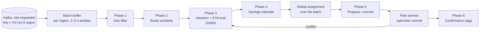
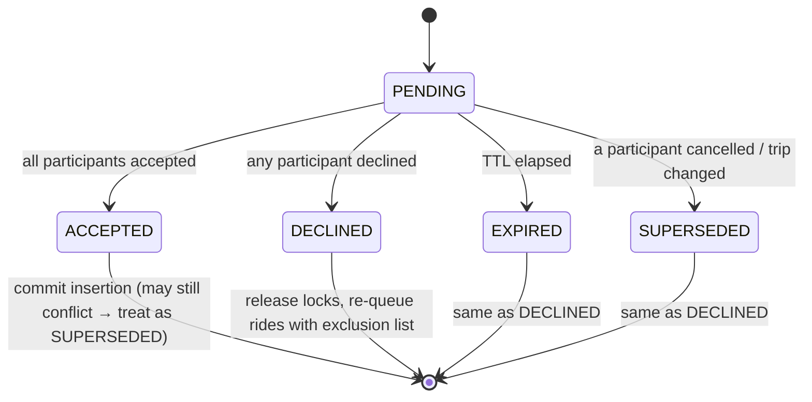

# 06 — Shared Ride Matching Algorithm

> Covers prompt section 8. This is the **core domain**, the part of the system that's a
> competitive advantage. It deserves the most design care and the most tests.

---

## 1. Problem statement

Given, at time *t*:
- **R** = Pool ride requests waiting to be matched (each with pickup, dropoff, seats, request time, detour budget),
- **T** = active Pool trips that still accept insertions (each with a vehicle, capacity, an ordered remaining stop list, and onboard riders with their own guarantees),
- **D** = available idle drivers,

find an assignment of requests to (existing trip + insertion positions) or (new trip with an
idle driver, possibly paired with another request) that **minimizes total cost**, subject to:

| Constraint | Type |
|---|---|
| Seats occupied ≤ capacity at every point in the stop sequence | Hard |
| Each ride's pickup precedes its drop-off | Hard |
| Pickup wait ≤ `max_wait` (e.g. 10 min) | Hard |
| Each rider's arrival ≤ `solo_eta + min(8 min, 0.4 × solo_duration)` | Hard (detour budget) |
| Already-onboard riders' guarantees are not violated | Hard |
| Completed stops are frozen | Hard |
| Minimize Σ(vehicle-minutes) + λ·Σ(rider-detour-minutes) + μ·Σ(rider-wait-minutes) | Objective |

This is a variant of the **Dial-a-Ride Problem (DARP)**, which is NP-hard. Every real system
uses heuristics within a time budget. Our goal is a good heuristic with **bounded latency**.

---

## 2. Architecture of the matcher



**Why batching instead of matching each request on arrival (greedy):**
Greedy commits request #1 to the best option *for it*, which may block a much better pairing
for #2 arriving 800 ms later. A 2–5 s window lets the matcher solve a small global
assignment problem. Uber has publicly described batched matching for both UberX dispatch and
Pool, and the "Wait & Save" product extended the window to minutes in exchange for a deeper discount.

**Tradeoff:** a longer window gives better matches but adds latency. Make `batch_window_ms` a
per-city config, emit `match_batch_size` and `match_quality` metrics, and tune.

**Why Kafka partition key = H3 region:** all requests in a region land on the same partition →
the same matcher instance → that instance can hold the region's state in memory and batch
without cross-instance coordination. **Hard edge case:** a rider near a region boundary. Solve
it by having each matcher also read candidate trips from neighboring regions (read-only via
Redis), while only *committing* through the Ride service, which is the serialization point.

---

## 3. The six phases

### Phase 1 — Geographical filtering (cheap, coarse)

Goal: reduce "every trip and driver in the city" to "the few dozen that could plausibly work".

- **Open Pool trips:** trips whose *current vehicle position* is within the pickup's H3 k-ring
  (k ≈ 3–5 at res 8, about 2–3 km) **and** that have ≥ `seats` free seats somewhere in their plan.
- **Waiting Pool requests** (for forming new pairs): same H3 bucket for pickup, and drop-off
  within *D* km.
- **Idle drivers:** Redis `GEOSEARCH` within `max_pickup_radius`.

Index: in-memory `dict[h3_cell, set[trip_id]]`, refreshed from `driver-location-updated` events.

### Phase 2 — Route similarity filtering (geometry, still cheap)

For each surviving trip candidate:
1. **Direction check:** angle between the request vector (pickup→dropoff) and the trip's
   remaining heading vector ≤ 60°.
2. **Corridor check:** pickup and drop-off are within *w* (≈ 400–800 m) of the trip's remaining
   planned route, and in the correct order along it (`ST_LineLocatePoint`, doc 05 §6.1).
3. **Cheap detour lower bound:** haversine detour × 1.3 (a road-network factor) > budget → reject.
   A **lower bound** is safe: it never rejects a feasible candidate, only obvious losers.

Typical reduction: 50 → 5 candidates.

### Phase 3 — ETA increase evaluation (insertion heuristic, expensive)

For each candidate trip with remaining stops `S = [s_1 … s_n]`, try inserting pickup *p* at
position *i* and drop-off *d* at position *j ≥ i*. For each (i, j):

- compute the new stop sequence's arrival times using a travel-time oracle (OSRM `table`
  matrix over the ≤ n+3 involved points, **one** call per candidate trip);
- check capacity at every position;
- check each rider's arrival vs. their deadline;
- compute Δcost = new_total_route_time − old_total_route_time.

**Slack-time optimization (important):** precompute for each stop *k* its *slack*: how much
later the vehicle could arrive at *k* without violating any downstream deadline:

```
slack[k] = min over m ≥ k of (deadline[m] − planned_arrival[m])
```

Then inserting a detour of δ before stop *k* is feasible iff δ ≤ slack[k]. This turns each
feasibility check from O(n) into O(1), so the full insertion scan is O(n²) instead of O(n³).
This is the standard trick from the DARP literature (Jaw et al., 1986) and the one to implement.

### Phase 4 — Fare saving estimation

For each feasible option, compute what each affected rider would pay and save, using the
pricing engine's pure functions (doc 07):

```
savings_r = solo_price_r − pool_price_r
```

Reject options where any rider's savings < `min_savings` (e.g. ₹20 or 10%). That's a product rule:
an insignificant discount isn't worth a detour.

In **opt-in mode**, riders already have a guaranteed upfront pool price, so this phase is
about **platform economics** (is this match profitable after driver pay?), not rider-facing
savings. In **proposal mode**, it produces the "Save ₹95" number.

### Global assignment over the batch

After phases 1–4 we have a bipartite graph: requests ↔ options (trip insertions, new pairs,
or solo dispatch), with edge weight = Δcost. Choose a conflict-free set of edges:

| Method | Complexity | Quality | Use |
|---|---|---|---|
| Greedy by best score | O(E log E) | Good | **Start here** |
| Hungarian algorithm (`scipy.optimize.linear_sum_assignment`) | O(n³) | Optimal for 1:1 | Batch ≤ a few hundred. Great learning exercise. |
| ILP over Request-Trip-Vehicle graph (Alonso-Mora et al., PNAS 2017) | Exponential worst case, with time limit | Near-optimal, N-way | Research/advanced (OR-Tools / PuLP) |

Conflict: two requests can't both claim the last seat of the same trip. Greedy handles it
by re-checking capacity when an edge is chosen. Hungarian handles it by construction for 1:1;
for multi-insert, re-plan losers in the next round.

### Phase 5 — Match proposal / commit

- **Opt-in mode:** call Ride service `commit_insertion(trip_id, expected_version, plan)`.
  The Ride service re-validates invariants and does the optimistic version check (doc 02 §3.1).
  On conflict → back to Phase 3 for that request with fresh state (max 3 retries, then fall
  back to a new trip or solo dispatch).
- **Proposal mode:** create a `MatchProposal` (status `PENDING`, TTL 20 s), lock the involved
  rides (`ride_proposal_lock`), and emit `match-proposed`. Riders see the offer.

### Phase 6 — Shared ride confirmation (proposal mode saga)

State machine for a proposal:



- Each response is an idempotent command: `respond(match_id, ride_id, ACCEPT|DECLINE)`.
- When the final acceptance arrives, the handler (in one DB transaction) marks the proposal
  `ACCEPTED`, commits the insertion with a version check, and writes the outbox events.
- A decline or expiry triggers **compensation**: release locks, put the rides back to `MATCHING`,
  add the pair to an exclusion set (Redis, TTL 10 min) so they're not re-proposed to each other.
- Timers live in `platform.scheduled_jobs` (durable). Alternative: Redis ZSET timers (faster, but lost on Redis failure). Temporal (best, heavier).

---

## 4. Pseudocode

```python
# ---- Matcher loop (one instance owns a set of H3 regions via Kafka partitions) ----

def run_matcher(consumer, region_state, clock):
    buffers = defaultdict(list)                 # region -> pending requests
    while True:
        for msg in consumer.poll(timeout_ms=100):
            req = RideRequested.parse(msg)
            buffers[req.region].append(req)

        for region, batch in list(buffers.items()):
            if batch and clock.now() - batch[0].received_at >= BATCH_WINDOW:
                with tracer.start_span("match_batch", attributes={"region": region, "size": len(batch)}):
                    match_batch(region_state[region], batch)
                buffers[region] = []
        consumer.commit()                        # at-least-once; commit after processing


def match_batch(state, requests):
    options = []                                 # (score, request, option)
    for req in requests:
        # Phase 1: geo filter
        trips   = state.open_pool_trips_near(req.pickup_cell, k_ring=4, min_free_seats=req.seats)
        waiting = state.waiting_requests_near(req, exclude=state.exclusions(req.rider_id))
        drivers = state.idle_drivers_near(req.pickup, radius_m=MAX_PICKUP_RADIUS)

        # Phase 2: route similarity (cheap geometry + lower bounds)
        trips   = [t for t in trips   if direction_ok(t, req) and corridor_ok(t, req)
                                        and detour_lower_bound(t, req) <= req.detour_budget]
        waiting = [w for w in waiting if direction_ok(w, req) and dropoff_close(w, req)]

        # Phase 3: exact insertion with travel-time oracle
        for trip in trips:
            plan = best_insertion(trip, req, eta_oracle)        # O(n^2) with slack times
            if plan:
                options.append(Option.insert(req, trip, plan))
        for other in waiting:
            if (plan := best_pair_plan(req, other, drivers, eta_oracle)):
                options.append(Option.pair(req, other, plan))
        if (solo := best_solo_dispatch(req, drivers, eta_oracle)):
            options.append(Option.solo(req, solo))              # always keep a fallback

    # Phase 4: economics / savings
    options = [o for o in options if savings_ok(o) and margin_ok(o)]
    for o in options:
        o.score = (o.delta_vehicle_seconds
                   + LAMBDA * o.total_added_rider_seconds
                   + MU * o.pickup_wait_seconds
                   - NU * o.platform_margin_minor)

    # Global assignment (greedy; swap for Hungarian later)
    chosen, used_requests, used_resources = [], set(), set()
    for o in sorted(options, key=lambda o: o.score):
        if o.requests & used_requests or o.resources & used_resources:
            continue
        chosen.append(o)
        used_requests |= o.requests
        used_resources |= o.resources             # driver ids / (trip_id, seat-slot)

    # Phase 5: commit or propose
    for o in chosen:
        if MODE == "OPT_IN":
            result = ride_service.commit(o.plan, expected_version=o.trip_version)
            if result.conflict:
                requeue_with_retry(o.requests)    # bounded retries
        else:
            proposal_service.create(o, ttl=PROPOSAL_TTL)

    for r in requests:                            # not matched this round
        if r not in used_requests:
            requeue_or_expire(r)                  # NO_DRIVERS after max_wait


def best_insertion(trip, req, eta):
    stops = trip.remaining_stops                  # s_0 = current vehicle position
    pts = [s.location for s in stops] + [req.pickup, req.dropoff]
    M = eta.matrix(pts)                           # one OSRM /table call
    base_cost = route_cost(stops, M)
    slack = compute_slack(stops, M)               # slack[k], O(n)
    load  = prefix_load(stops)                    # seats occupied after each stop

    best = None
    for i in range(1, len(stops) + 1):            # pickup goes before stops[i]
        if load[i - 1] + req.seats > trip.capacity:
            continue
        for j in range(i, len(stops) + 1):        # dropoff goes before stops[j]
            if any_load_exceeds(load, i, j, req.seats, trip.capacity):  # O(1) via range-max table
                break                             # all larger j also violate
            delta, new_plan = splice_cost(stops, i, j, req, M)
            if not respects_slack(delta, slack, i, j) or not req_deadlines_ok(new_plan, req):
                continue
            if best is None or delta < best.delta:
                best = Plan(i, j, delta, new_plan)
    return best
```

---

## 5. Time complexity analysis

Let:
- *B* = requests in a batch (per region), *C* = candidate trips per request after Phase 2,
- *n* = remaining stops per trip (≤ 2 × max_riders, so ≤ 6 for 3-rider pools),
- *W* = waiting requests per request after the geo filter, *K* = idle-driver candidates.

| Step | Cost per request | Notes |
|---|---|---|
| Phase 1 (H3 lookup) | O(k² + candidates) | k-ring has 3k²+3k+1 cells. Effectively constant. |
| Phase 1 (Redis GEOSEARCH) | O(log N_drivers + K) | |
| Phase 2 | O(C₀) with O(1) geometry per candidate | C₀ = pre-filter candidates |
| Phase 3 insertion | O(C · n²) with slack times (O(C · n³) naive) | + **C OSRM calls** (the real latency cost: ~5–20 ms each, parallelizable) |
| Phase 3 pairing | O(W · K) | |
| Phase 4 | O(options) | |
| Greedy assignment | O(E log E), E = total options ≈ B·(C + W + 1) | |
| Hungarian (alternative) | O(max(B, resources)³) | |

**Per batch:** O(B · (C·n² + W·K)) compute + O(B·C) routing calls.

With realistic values (B = 50, C = 5, n = 4, W = 5, K = 10) that's ~6k insertion
evaluations: microseconds of CPU. **Routing calls dominate**: 250 OSRM `table` calls.
Executed concurrently (asyncio, ~20 in flight) at ~10 ms each, that's ~125 ms per batch.
The cache (doc 10) cuts it further. So the < 2 s match target is comfortably met; the
budget is spent on the batch window, not on computation.

**Scaling property:** cost is linear in requests per region and independent of city size,
because Phase 1 bounds candidates *geographically*. That's why geo-sharding works.

---

## 6. How Uber Pool likely solves this (public information + educated inference)

- **Batched matching** over short windows, explicitly described by Uber as replacing
  greedy dispatch for better global efficiency.
- **Upfront, guaranteed pricing** for Pool, with matching hidden from the rider.
- **Insertion-based planning** on active trips with **detour constraints** and per-rider ETA guarantees.
- **Geo-sharded, in-memory dispatch**: each instance owns geography (Ringpop/consistent hashing historically; H3 everywhere).
- **ML ETAs** (DeepETA, publicly described in 2022) on top of a routing engine for accurate time estimates, which are central to detour feasibility.
- **Walking to meeting points** (Express Pool, 2018) to reduce detours: the optimization space includes moving the *pickup*, not just the vehicle.
- **Marketplace-level objectives** (efficiency, supply utilization) rather than per-rider optimality.

Academic references worth reading:
- Santi et al., *Quantifying the benefits of vehicle pooling with shareability networks*, PNAS 2014.
- Alonso-Mora et al., *On-demand high-capacity ride-sharing via dynamic trip-vehicle assignment*, PNAS 2017 (the RTV graph).
- Cordeau & Laporte, *The dial-a-ride problem: models and algorithms*, 2007.

---

## 7. What to build, in order (solo-dev plan)

1. **Solo dispatch** only: Redis GEO nearest + OSRM ETA ranking. Greedy, no batching.
2. **Pool, pairs only** (two waiting requests → new trip), greedy, batch window 3 s.
3. **En-route insertion** into active trips with slack times. *This is the core skill.*
4. **Optimistic concurrency** on trips + conflict retry. Write a test that runs two matchers concurrently.
5. **Proposal mode** saga with durable timers.
6. **Hungarian assignment** + an offline **simulator** (replay synthetic demand, compare greedy vs. Hungarian on vehicle-km saved). The simulator is the most valuable artifact: it's how real marketplace teams evaluate algorithm changes before shipping.
7. **Geo-sharded matchers** (partition by H3 region), plus boundary handling.