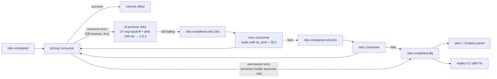
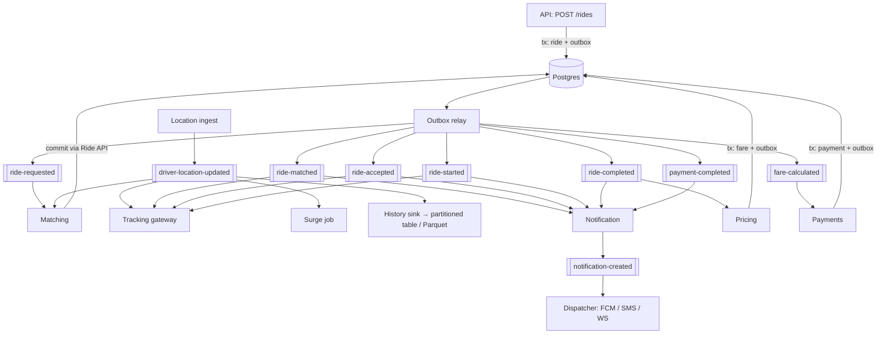

# 09 — Event-Driven Architecture (Kafka)

> Covers prompt section 11.

---

## 1. Principles

1. **Events are facts, not commands.** `ride-completed` means "this happened". Consumers decide what to do. (Commands such as "capture this payment" go over sync APIs or explicit command topics, named in imperative form.)
2. **Publish via the transactional outbox only** (doc 16). Never `producer.send()` inside a request handler after `commit()`.
3. **At-least-once delivery + idempotent consumers** = effectively-once processing. Kafka's
   exactly-once (EOS) transactions only cover Kafka→Kafka pipelines. The moment a consumer
   writes to Postgres or calls a PSP, you need idempotency yourself.
4. **The partition key defines the ordering scope.** Choose it from the question "which events must be processed in order?"
5. **Schemas are contracts.** They are versioned, validated in CI, and backward-compatible by default.

---

## 2. Cluster configuration

| Setting | Value | Why |
|---|---|---|
| Mode | KRaft (no ZooKeeper) | ZooKeeper support was removed in Kafka 4.0. |
| Brokers | 1 locally, 3 in staging/prod | 3 is the minimum for RF = 3. |
| `replication.factor` | 3 | Survives 1 broker loss with no data loss. |
| `min.insync.replicas` | 2 | With `acks=all`, a write needs 2 replicas. |
| Producer `acks` | `all` (critical topics), `1` (location) | Durability vs. latency per topic. |
| Producer `enable.idempotence` | `true` | No duplicates from producer retries; ordering per partition preserved. |
| Consumer `enable.auto.commit` | `false` | Commit offsets **after** processing. |
| Consumer `isolation.level` | `read_committed` | |
| `auto.create.topics.enable` | `false` | Topics are infrastructure; create them via code (Strimzi `KafkaTopic` CRD). |

Python client: **`confluent-kafka`** (librdkafka, fast, full-featured). `aiokafka` is the
async-native alternative. In async FastAPI workers, run `confluent-kafka` polling in a
thread or use its `AIOProducer` wrapper. For the relay and consumers (separate processes),
a plain synchronous loop is simplest and fastest.

On Kubernetes, deploy Kafka with **Strimzi** (operator). It's the most-used way to run Kafka on K8s.

---

## 3. Event envelope (every message)

Use **CloudEvents**-style attributes in Kafka headers plus the payload in the value:

```
Headers:
  ce_id:            01933c41-8f2e-7b3a-...      (event_id, UUIDv7: dedupe key)
  ce_type:          rideshare.ride.requested.v1
  ce_source:        rides-module
  ce_time:          2026-11-13T10:15:02.123Z
  ce_subject:       ride/01933c41-...
  content-type:     application/json         (or application/avro with Schema Registry)
  traceparent:      00-4bf92f3577b34da6a3ce929d0e0e4736-00f067aa0ba902b7-01
  schema_version:   1
Key:   <partition key>
Value: <payload JSON>
```

`traceparent` in headers is how one distributed trace spans HTTP → outbox → Kafka → consumer
(doc 13). Most teams forget this, and their traces stop at the broker.

**Serialization decision:** start with **JSON + JSON Schema** files in `contracts/events/`,
validated in tests. Move to **Avro or Protobuf with a Schema Registry** (Confluent or
Apicurio) when you extract services. The registry enforces compatibility at produce time.
Avro/Protobuf are 3–10× smaller than JSON, which matters for location events.

---

## 4. Topics

| Topic | Producer | Consumers | Partition key | Partitions (stage 3) | Retention | acks |
|---|---|---|---|---|---|---|
| `ride-requested` | Ride (outbox) | Matching | `region` (H3 res-5 of pickup) | 24 | 3 d | all |
| `ride-matched` | Ride (outbox) | Notification, Tracking gateway, Analytics | `ride_id` | 12 | 7 d | all |
| `ride-accepted` | Ride (outbox) | Notification, Tracking gateway, Payments (pre-auth) | `ride_id` | 12 | 7 d | all |
| `ride-started` | Ride (outbox) | Notification, Tracking, Analytics | `ride_id` | 12 | 7 d | all |
| `ride-completed` | Ride (outbox) | Pricing, Driver (stats), Notification, Analytics | `ride_id` | 12 | 30 d | all |
| `driver-location-updated` | Location ingest (direct; no outbox needed) | Matching, Tracking gateway, Surge, History sink | `driver_id` | 48 | 24 h | 1 |
| `fare-calculated` | Pricing (outbox) | Payments, Notification, Analytics | `ride_id` | 12 | 30 d | all |
| `payment-completed` | Payments (outbox) | Ride (receipt state), Notification, Ledger/Analytics | `ride_id` | 12 | 30 d | all |
| `notification-created` | Any module (outbox) | Notification dispatcher | `user_id` | 12 | 3 d | all |
| `match-proposed` *(extra)* | Matching | Ride (proposal saga), Notification | `ride_id` (initiator) | 12 | 3 d | all |
| `<topic>.retry.30s`, `.retry.5m` | Consumers | Same consumer group (delayed) | same | same | 1 d | all |
| `<topic>.dlq` | Consumers | Humans + replay tool | same | 3 | 14 d | all |

### Partition key reasoning

- **`ride_id`** for lifecycle events: all events for one ride are ordered (`accepted` before `started` before `completed`). Different rides parallelize freely.
- **`region`** for `ride-requested`: the matcher needs *all requests in a region* on one consumer to batch them. Tradeoff: **hot partitions**. Downtown at rush hour can overload one partition. Mitigations: finer regions (res 6) for dense cities, or a consistent-hash ring of sub-regions. Measure per-partition lag.
- **`driver_id`** for locations: ordering per driver matters (don't apply an older ping after a newer one). Also guard on `recorded_at` monotonicity in the consumer; ordering across partition rebalances isn't bulletproof.
- **`user_id`** for notifications: per-user ordering and natural per-user rate limiting.

**Partition count** sets the parallelism ceiling (max consumers per group = partitions).
Increasing it later **reshuffles key → partition mapping** and breaks ordering during the
transition, so over-provision moderately up front (e.g. 12–48).

---

## 5. Retry and Dead Letter Queue strategy



**Error classification is the key design step:**

| Class | Examples | Action |
|---|---|---|
| Transient | DB connection error, timeout, PSP 503, OSRM unavailable | Retry (in-process → retry topics) |
| Permanent | Schema validation failure, unknown `ce_type`, referenced entity missing after N tries, business invariant violation | DLQ immediately, no retries |
| Poison pill | Deserialization crash | DLQ with the raw bytes |

**Ordering caveat:** sending a message to a retry topic lets later messages for the *same key*
overtake it. For `ride_id`-keyed lifecycle topics that may matter (`completed` processed before
`started`). Two options:
1. Make consumers **state-machine aware**: they ignore or park events whose preconditions aren't met yet. Recommended; it's more robust anyway.
2. Use **blocking retries** for strictly ordered topics (retry in place, pausing the partition). Simpler, but one bad message halts the partition, which makes DLQ alerting essential.

DLQ message = original key/value/headers + `dlq_reason`, `dlq_exception`, `dlq_original_topic`,
`dlq_original_partition`, `dlq_original_offset`, `dlq_failed_at`, `dlq_consumer_group`.
A `scripts/dlq_replay.py --topic X.dlq --filter ... --to X` tool is part of the deliverable.

### Per-topic retry policy

| Topic → consumer | In-process retries | Retry topics | DLQ | Notes |
|---|---|---|---|---|
| `ride-requested` → matching | 2 | **none** | yes | Stale matches are worthless. On failure, re-publish with `attempt+1` until `max_wait`, then mark `NO_DRIVERS`. |
| `ride-completed` → pricing | 3 | 30 s, 5 m | yes | Fare must eventually be computed; it's idempotent via `UNIQUE(ride_id)`. |
| `fare-calculated` → payments | 3 | 30 s, 5 m, 1 h | yes | PSP outages can last hours. Idempotency key = `fare_id`. |
| `driver-location-updated` → any | 0 | none | **no** | Drop and count. The next ping arrives in 4 s. |
| `notification-created` → dispatcher | 3 | 30 s | yes | Expire notifications older than their TTL instead of sending late ("Your driver has arrived" 10 min late is harmful). |
| `payment-completed` → ride | 3 | 30 s, 5 m | yes | |

---

## 6. Message schemas

All payloads share these fields: `event_id`, `event_type`, `occurred_at`, `schema_version`.
Shown below are the payload-specific fields. Full JSON Schemas live in `contracts/events/`.

```json
// ride-requested v1                         key = "85618607fffffff" (H3 res-5 region)
{
  "event_id": "01933c41-8f2e-7b3a-9c00-aa11bb22cc33",
  "event_type": "ride.requested",
  "schema_version": 1,
  "occurred_at": "2026-11-13T10:15:02.123Z",
  "ride_id": "01933c41-...",
  "rider_id": "01933c3e-...",
  "city_code": "HYD",
  "region": "85618607fffffff",
  "product": "POOL",
  "seats": 1,
  "pickup":  { "lat": 17.4401, "lng": 78.3489, "h3_r9": "89618607ab3ffff" },
  "dropoff": { "lat": 17.4126, "lng": 78.4482 },
  "solo_duration_s": 1560,
  "max_pickup_at": "2026-11-13T10:25:02Z",
  "max_dropoff_at": "2026-11-13T10:49:02Z",
  "quote_id": "01933c40-...",
  "attempt": 1
}
```

```json
// ride-matched v1                           key = ride_id
{
  "event_id": "...", "event_type": "ride.matched", "schema_version": 1, "occurred_at": "...",
  "ride_id": "01933c41-...",
  "trip_id": "01933c43-...",
  "trip_mode": "POOL",
  "driver_id": "01933b00-...",
  "vehicle_id": "01933b01-...",
  "trip_version": 8,
  "stops": [
    { "stop_id": "...", "ride_id": "01933c10-...", "kind": "DROPOFF", "seq": 3, "eta": "..." },
    { "stop_id": "...", "ride_id": "01933c41-...", "kind": "PICKUP",  "seq": 2, "eta": "..." },
    { "stop_id": "...", "ride_id": "01933c41-...", "kind": "DROPOFF", "seq": 4, "eta": "..." }
  ],
  "pickup_eta": "2026-11-13T10:22:00Z",
  "match_latency_ms": 1430,
  "algorithm": "insertion_v1"
}
```

```json
// ride-accepted v1  (driver accepted the offer)          key = ride_id
{ "event_id": "...", "event_type": "ride.accepted", "schema_version": 1, "occurred_at": "...",
  "ride_id": "...", "trip_id": "...", "driver_id": "...", "vehicle_id": "...",
  "offer_id": "...", "offer_latency_ms": 4200, "pickup_eta": "..." }
```

```json
// ride-started v1  (this rider was picked up)            key = ride_id
{ "event_id": "...", "event_type": "ride.started", "schema_version": 1, "occurred_at": "...",
  "ride_id": "...", "trip_id": "...", "driver_id": "...",
  "picked_up_at": "...", "pickup_location": { "lat": 17.44, "lng": 78.35 },
  "wait_time_s": 45 }
```

```json
// ride-completed v1                         key = ride_id
{ "event_id": "...", "event_type": "ride.completed", "schema_version": 1, "occurred_at": "...",
  "ride_id": "...", "trip_id": "...", "rider_id": "...", "driver_id": "...",
  "product": "POOL",
  "quote_id": "...",
  "picked_up_at": "...", "dropped_off_at": "...",
  "actual_distance_m": 12380, "actual_duration_s": 1710,
  "segments": [
    { "seq": 1, "distance_m": 7000, "duration_s": 960, "onboard_ride_ids": ["A"] },
    { "seq": 2, "distance_m": 5000, "duration_s": 720, "onboard_ride_ids": ["A","B"] }
  ],
  "trip_completed": false }
```

```json
// driver-location-updated v1                key = driver_id   (Avro/Protobuf strongly recommended)
{ "event_id": "...", "event_type": "driver.location_updated", "schema_version": 1,
  "driver_id": "...", "city_code": "HYD",
  "lat": 17.4403, "lng": 78.3497, "h3_r9": "89618607ab3ffff",
  "heading_deg": 90, "speed_mps": 8.9, "accuracy_m": 5.0,
  "availability": "ON_TRIP", "trip_id": "...",
  "recorded_at": "2026-11-13T10:00:08Z", "received_at": "2026-11-13T10:00:08.140Z" }
```

```json
// fare-calculated v1                        key = ride_id
{ "event_id": "...", "event_type": "fare.calculated", "schema_version": 1, "occurred_at": "...",
  "fare_id": "...", "ride_id": "...", "rider_id": "...", "trip_id": "...",
  "algorithm": "upfront_v1",
  "total": { "amount_minor": 36700, "currency": "INR" },
  "line_items": [ { "type": "BASE", "amount_minor": 5000 }, { "type": "POOL_DISCOUNT", "amount_minor": -7344 } ],
  "payment_method_id": "pm_01..." }
```

```json
// payment-completed v1                      key = ride_id
{ "event_id": "...", "event_type": "payment.completed", "schema_version": 1, "occurred_at": "...",
  "payment_id": "...", "fare_id": "...", "ride_id": "...", "rider_id": "...",
  "status": "CAPTURED",
  "amount": { "amount_minor": 36700, "currency": "INR" },
  "method": "UPI", "psp": "razorpay", "psp_payment_id": "pay_N1x..." }
```

```json
// notification-created v1                   key = user_id
{ "event_id": "...", "event_type": "notification.created", "schema_version": 1, "occurred_at": "...",
  "notification_id": "...", "user_id": "...",
  "channels": ["PUSH", "WEBSOCKET"],
  "template": "driver_arriving",
  "params": { "driver_first_name": "Ravi", "eta_min": 2 },
  "expires_at": "2026-11-13T10:24:00Z",
  "dedupe_key": "ride:01933c41:driver_arriving",
  "priority": "HIGH" }
```

### Schema evolution rules

- **Backward-compatible changes (allowed in v1):** add an optional field; widen an enum *only if consumers tolerate unknown values* (tell them to).
- **Breaking changes:** remove/rename a field, change a type or meaning → publish `v2` on a new `ce_type` (and usually a new topic `ride-completed.v2`), dual-publish during migration, retire v1 when consumer lag on v1 is zero and no consumers are registered.
- Test it: a **contract test** loads every historical schema version and validates that the current consumer parses examples of each (doc 15).

---

## 7. Consumer template (idempotent, traced, classified errors)

```python
def handle(msg, session_factory, handler, group: str):
    event_id = header(msg, "ce_id")
    ctx = otel_propagator.extract(headers_to_dict(msg.headers()))
    with tracer.start_as_current_span(f"consume {msg.topic()}", context=ctx, kind=SpanKind.CONSUMER):
        try:
            payload = schemas.validate(msg)                       # PermanentError on failure
            with session_factory.begin() as s:                    # one transaction:
                inserted = s.execute(
                    insert(processed_events).values(consumer_group=group, event_id=event_id)
                    .on_conflict_do_nothing()).rowcount
                if not inserted:
                    metrics.duplicates.labels(group).inc()
                    return                                        # already processed
                handler(s, payload)                               # domain logic + outbox writes
        except PermanentError as e:
            dlq.send(msg, reason=e)
        except TransientError as e:
            retry_router.route(msg, e)                            # next retry topic or DLQ
```

The `processed_events` insert and the handler's writes **commit atomically**. That's what
makes processing effectively-once. (The inbox pattern is the outbox's mirror image.)

---

## 8. End-to-end event flow

