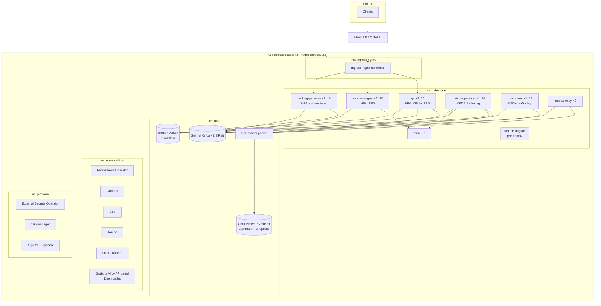

# 11 — Kubernetes Design

> Covers prompt section 13.

---

## 1. Cluster architecture



**Local learning cluster:** `kind` or `k3d` (both run in Docker on Windows via WSL2) with 3
nodes. **Cloud:** GKE Autopilot, EKS, or AKS free tier credits. Same manifests via Kustomize overlays.

---

## 2. Namespaces

| Namespace | Contents | Why separate |
|---|---|---|
| `rideshare` (+ `rideshare-staging`) | App workloads | RBAC, quotas, NetworkPolicies per environment |
| `data` | Postgres, Redis, Kafka (operators + CRs) | Different lifecycle, backup policies, stricter access |
| `observability` | Prometheus, Grafana, Loki, Tempo, OTel | Shared platform; survives app namespace deletion |
| `ingress-nginx` | Ingress controller | Cluster-wide edge |
| `platform` | cert-manager, External Secrets, Argo CD, KEDA | Cluster add-ons |

Apply a **ResourceQuota** and **LimitRange** to app namespaces so that one bad deploy can't
starve the cluster, and **Pod Security Admission** `restricted` on `rideshare`.

---

## 3. Manifests (Kustomize base)

### 3.1 Deployment: API

```yaml
apiVersion: apps/v1
kind: Deployment
metadata:
  name: api
  namespace: rideshare
  labels: { app.kubernetes.io/name: api, app.kubernetes.io/part-of: rideshare }
spec:
  replicas: 3
  revisionHistoryLimit: 5
  strategy:
    type: RollingUpdate
    rollingUpdate: { maxSurge: 25%, maxUnavailable: 0 }   # never reduce capacity during rollout
  selector:
    matchLabels: { app.kubernetes.io/name: api }
  template:
    metadata:
      labels: { app.kubernetes.io/name: api, app.kubernetes.io/part-of: rideshare }
    spec:
      serviceAccountName: api
      automountServiceAccountToken: false
      terminationGracePeriodSeconds: 30
      securityContext:
        runAsNonRoot: true
        runAsUser: 10001
        fsGroup: 10001
        seccompProfile: { type: RuntimeDefault }
      topologySpreadConstraints:                 # spread across zones and nodes
        - maxSkew: 1
          topologyKey: topology.kubernetes.io/zone
          whenUnsatisfiable: ScheduleAnyway
          labelSelector: { matchLabels: { app.kubernetes.io/name: api } }
        - maxSkew: 1
          topologyKey: kubernetes.io/hostname
          whenUnsatisfiable: DoNotSchedule
          labelSelector: { matchLabels: { app.kubernetes.io/name: api } }
      containers:
        - name: api
          image: ghcr.io/OWNER/rideshare:sha-abc1234      # immutable tag; set by CI (kustomize edit set image)
          imagePullPolicy: IfNotPresent
          command: ["uvicorn", "src.app:app",
                    "--host", "0.0.0.0", "--port", "8000",
                    "--workers", "1",                    # 1 worker per pod; scale with pods, not workers
                    "--timeout-graceful-shutdown", "20",
                    "--proxy-headers", "--forwarded-allow-ips", "*"]
          ports:
            - { name: http, containerPort: 8000 }
            - { name: metrics, containerPort: 9100 }
          envFrom:
            - configMapRef: { name: rideshare-config }
            - secretRef: { name: rideshare-secrets }
          env:
            - name: OTEL_SERVICE_NAME
              value: api
            - name: OTEL_RESOURCE_ATTRIBUTES
              value: "deployment.environment=prod,service.version=$(APP_VERSION)"
            - name: POD_NAME
              valueFrom: { fieldRef: { fieldPath: metadata.name } }
          resources:
            requests: { cpu: 250m, memory: 256Mi }
            limits:   { memory: 512Mi }               # memory limit yes; CPU limit no (see §5)
          startupProbe:
            httpGet: { path: /healthz/live, port: http }
            periodSeconds: 2
            failureThreshold: 30                      # up to 60 s to boot
          livenessProbe:
            httpGet: { path: /healthz/live, port: http }
            periodSeconds: 10
            failureThreshold: 3
          readinessProbe:
            httpGet: { path: /healthz/ready, port: http }
            periodSeconds: 5
            failureThreshold: 2
          lifecycle:
            preStop:
              exec: { command: ["sleep", "5"] }       # let endpoints/ingress deregister before SIGTERM
          securityContext:
            allowPrivilegeEscalation: false
            readOnlyRootFilesystem: true
            capabilities: { drop: ["ALL"] }
          volumeMounts:
            - { name: tmp, mountPath: /tmp }
      volumes:
        - name: tmp
          emptyDir: {}
```

### 3.2 Worker deployment (same image, different command)

```yaml
apiVersion: apps/v1
kind: Deployment
metadata: { name: matching-worker, namespace: rideshare }
spec:
  replicas: 2
  selector: { matchLabels: { app.kubernetes.io/name: matching-worker } }
  template:
    metadata: { labels: { app.kubernetes.io/name: matching-worker } }
    spec:
      terminationGracePeriodSeconds: 60          # finish the batch, commit offsets, leave the group cleanly
      containers:
        - name: worker
          image: ghcr.io/OWNER/rideshare:sha-abc1234
          command: ["python", "-m", "src.workers.matching_worker"]
          envFrom:
            - configMapRef: { name: rideshare-config }
            - secretRef: { name: rideshare-secrets }
          env:
            - { name: KAFKA_GROUP_ID, value: matching }
            - { name: OTEL_SERVICE_NAME, value: matching-worker }
          ports: [ { name: metrics, containerPort: 9100 } ]
          resources:
            requests: { cpu: 500m, memory: 384Mi }
            limits:   { memory: 768Mi }
          livenessProbe:                         # worker writes a heartbeat file each poll loop
            exec: { command: ["python", "-m", "src.workers.healthcheck", "--max-age", "30"] }
            periodSeconds: 15
```

### 3.3 Services

```yaml
apiVersion: v1
kind: Service
metadata: { name: api, namespace: rideshare, labels: { app.kubernetes.io/name: api } }
spec:
  selector: { app.kubernetes.io/name: api }
  ports:
    - { name: http, port: 80, targetPort: http }
    - { name: metrics, port: 9100, targetPort: metrics }
---
apiVersion: v1
kind: Service
metadata: { name: tracking-gateway, namespace: rideshare }
spec:
  selector: { app.kubernetes.io/name: tracking-gateway }
  ports: [ { name: http, port: 80, targetPort: 8000 } ]
```

### 3.4 Ingress (TLS, rate limiting, WebSockets)

```yaml
apiVersion: networking.k8s.io/v1
kind: Ingress
metadata:
  name: rideshare
  namespace: rideshare
  annotations:
    cert-manager.io/cluster-issuer: letsencrypt-prod
    nginx.ingress.kubernetes.io/ssl-redirect: "true"
    nginx.ingress.kubernetes.io/proxy-body-size: "1m"
    nginx.ingress.kubernetes.io/limit-rps: "50"              # coarse edge limit per client IP; fine limits in-app
    nginx.ingress.kubernetes.io/limit-burst-multiplier: "3"
    nginx.ingress.kubernetes.io/enable-opentelemetry: "true"
spec:
  ingressClassName: nginx
  tls:
    - hosts: [api.rideshare.dev]
      secretName: api-rideshare-tls
  rules:
    - host: api.rideshare.dev
      http:
        paths:
          - path: /v1/ws
            pathType: Prefix
            backend: { service: { name: tracking-gateway, port: { name: http } } }
          - path: /v1/drivers/me/locations
            pathType: Exact
            backend: { service: { name: location-ingest, port: { name: http } } }
          - path: /
            pathType: Prefix
            backend: { service: { name: api, port: { name: http } } }
---
# WebSockets need long timeouts. Use a separate Ingress so the annotation doesn't affect REST.
apiVersion: networking.k8s.io/v1
kind: Ingress
metadata:
  name: rideshare-ws
  namespace: rideshare
  annotations:
    nginx.ingress.kubernetes.io/proxy-read-timeout: "3600"
    nginx.ingress.kubernetes.io/proxy-send-timeout: "3600"
spec:
  ingressClassName: nginx
  tls: [ { hosts: [ws.rideshare.dev], secretName: ws-rideshare-tls } ]
  rules:
    - host: ws.rideshare.dev
      http:
        paths:
          - path: /
            pathType: Prefix
            backend: { service: { name: tracking-gateway, port: { name: http } } }
```

Ingress-NGINX is in maintenance-only mode as of 2025–2026, and the community is moving to the
**Gateway API** (Envoy Gateway, Cilium, Istio, NGINX Gateway Fabric). Use Ingress first
(simpler, more examples), then migrate to `Gateway` + `HTTPRoute` as a learning milestone.

### 3.5 ConfigMap and Secrets

```yaml
apiVersion: v1
kind: ConfigMap
metadata: { name: rideshare-config, namespace: rideshare }
data:
  APP_ENV: prod
  LOG_LEVEL: INFO
  LOG_FORMAT: json
  DB_HOST: rideshare-pooler-rw.data.svc.cluster.local     # PgBouncer from CloudNativePG
  DB_PORT: "5432"
  DB_NAME: rideshare
  DB_POOL_SIZE: "10"
  DB_STATEMENT_TIMEOUT_MS: "2000"
  REDIS_URL: redis://redis-master.data.svc.cluster.local:6379/0
  KAFKA_BOOTSTRAP: rideshare-kafka-bootstrap.data.svc.cluster.local:9092
  OSRM_URL: http://osrm.rideshare.svc.cluster.local:5000
  OTEL_EXPORTER_OTLP_ENDPOINT: http://otel-collector.observability.svc.cluster.local:4317
  MATCH_BATCH_WINDOW_MS: "3000"
  POOL_PROPOSAL_MODE_PERCENT: "0"
  ACCESS_TOKEN_TTL_S: "900"
```

```yaml
# Secrets are NOT committed. External Secrets Operator syncs them from a vault
# (AWS Secrets Manager / GCP Secret Manager / Azure Key Vault / HashiCorp Vault).
apiVersion: external-secrets.io/v1
kind: ExternalSecret
metadata: { name: rideshare-secrets, namespace: rideshare }
spec:
  refreshInterval: 1h
  secretStoreRef: { kind: ClusterSecretStore, name: cloud-secrets }
  target: { name: rideshare-secrets, creationPolicy: Owner }
  data:
    - { secretKey: DB_PASSWORD,      remoteRef: { key: rideshare/prod/db,    property: password } }
    - { secretKey: JWT_PRIVATE_KEY,  remoteRef: { key: rideshare/prod/jwt,   property: private_key_pem } }
    - { secretKey: PSP_API_KEY,      remoteRef: { key: rideshare/prod/psp,   property: api_key } }
    - { secretKey: PSP_WEBHOOK_SECRET, remoteRef: { key: rideshare/prod/psp, property: webhook_secret } }
```

Local/kind alternative: **Sealed Secrets** (encrypted secrets committed to Git) or **SOPS + age**.
Never commit plain `Secret` YAML: base64 is encoding, not encryption.

### 3.6 HPA (CPU + custom metric) and KEDA (Kafka lag)

```yaml
apiVersion: autoscaling/v2
kind: HorizontalPodAutoscaler
metadata: { name: api, namespace: rideshare }
spec:
  scaleTargetRef: { apiVersion: apps/v1, kind: Deployment, name: api }
  minReplicas: 3
  maxReplicas: 20
  metrics:
    - type: Resource
      resource: { name: cpu, target: { type: Utilization, averageUtilization: 65 } }
    - type: Pods                                       # via prometheus-adapter
      pods:
        metric: { name: http_requests_per_second }
        target: { type: AverageValue, averageValue: "150" }
  behavior:
    scaleUp:
      stabilizationWindowSeconds: 0
      policies: [ { type: Percent, value: 100, periodSeconds: 30 } ]
    scaleDown:
      stabilizationWindowSeconds: 300                  # avoid flapping
      policies: [ { type: Percent, value: 20, periodSeconds: 60 } ]
---
apiVersion: keda.sh/v1alpha1
kind: ScaledObject
metadata: { name: matching-worker, namespace: rideshare }
spec:
  scaleTargetRef: { name: matching-worker }
  minReplicaCount: 1
  maxReplicaCount: 24                                  # ≤ partitions of ride-requested
  triggers:
    - type: kafka
      metadata:
        bootstrapServers: rideshare-kafka-bootstrap.data.svc.cluster.local:9092
        consumerGroup: matching
        topic: ride-requested
        lagThreshold: "50"
```

**Why KEDA for consumers:** CPU is a poor scaling signal for I/O-bound consumers. **Lag** is the
real backlog signal. Cap `maxReplicaCount` at the partition count, since extra consumers sit idle.

### 3.7 PodDisruptionBudget, NetworkPolicy, migration Job

```yaml
apiVersion: policy/v1
kind: PodDisruptionBudget
metadata: { name: api, namespace: rideshare }
spec:
  minAvailable: 2
  selector: { matchLabels: { app.kubernetes.io/name: api } }
---
apiVersion: networking.k8s.io/v1
kind: NetworkPolicy
metadata: { name: default-deny, namespace: rideshare }
spec:
  podSelector: {}
  policyTypes: [Ingress]
---
apiVersion: networking.k8s.io/v1
kind: NetworkPolicy
metadata: { name: api-from-ingress, namespace: rideshare }
spec:
  podSelector: { matchLabels: { app.kubernetes.io/name: api } }
  ingress:
    - from:
        - namespaceSelector: { matchLabels: { kubernetes.io/metadata.name: ingress-nginx } }
      ports: [ { port: 8000 } ]
    - from:
        - namespaceSelector: { matchLabels: { kubernetes.io/metadata.name: observability } }
      ports: [ { port: 9100 } ]
---
apiVersion: batch/v1
kind: Job
metadata:
  name: db-migrate-sha-abc1234                 # unique per release
  namespace: rideshare
spec:
  backoffLimit: 0                              # never auto-retry a migration
  activeDeadlineSeconds: 600
  ttlSecondsAfterFinished: 86400
  template:
    spec:
      restartPolicy: Never
      containers:
        - name: migrate
          image: ghcr.io/OWNER/rideshare:sha-abc1234
          command: ["alembic", "upgrade", "head"]
          envFrom: [ { configMapRef: { name: rideshare-config } }, { secretRef: { name: rideshare-migrator-secrets } } ]
```

The migrator uses a **separate DB role** with DDL rights; the app role has only DML rights.
Run migrations as a pipeline step before rollout, not as an init container. With init
containers, every replica races to migrate.

### 3.8 Kustomize layout

```
deploy/k8s/
  base/            kustomization.yaml, api.yaml, location-ingest.yaml, tracking-gateway.yaml,
                   matching-worker.yaml, consumers.yaml, outbox-relay.yaml, osrm.yaml,
                   services.yaml, ingress.yaml, hpa.yaml, keda.yaml, pdb.yaml,
                   networkpolicies.yaml, configmap.yaml, externalsecret.yaml, servicemonitor.yaml
  overlays/
    dev/           replicas: 1, no HPA, kind-friendly resources, local secrets
    staging/       prod-like, smaller
    prod/          full HPA/PDB, topology spread, prod config
```

---

## 4. Resource sizing (starting points; tune with load tests)

| Workload | Requests (cpu/mem) | Memory limit | Replicas (min–max) | Scale signal |
|---|---|---|---|---|
| api | 250m / 256Mi | 512Mi | 3–20 | CPU 65%, RPS/pod |
| location-ingest | 200m / 192Mi | 384Mi | 2–20 | RPS/pod |
| tracking-gateway | 200m / 256Mi | 1Gi | 2–10 | Connections/pod (~5k) |
| matching-worker | 500m / 384Mi | 768Mi | 1–24 | Kafka lag |
| consumers | 200m / 256Mi | 512Mi | 1–12 | Kafka lag |
| outbox-relay | 100m / 128Mi | 256Mi | 2 (active/standby via `SKIP LOCKED`) | — |
| osrm | 500m / 2Gi (region extract) | 3Gi | 2 | CPU |

---

## 5. Production best practices (and the reasons)

| Practice | Why |
|---|---|
| **Memory limit = hard; CPU limit: none or generous** | CPU limits cause CFS throttling (latency spikes even when nodes are idle). Memory over-use must be bounded, or the OOM killer picks random victims. Many orgs (and Kubernetes maintainers) recommend no CPU limits for latency-sensitive services. Set requests accurately instead. |
| **requests = realistic p50 usage** | The scheduler packs pods by requests. Under-requesting causes noisy neighbors; over-requesting wastes money. |
| **One uvicorn worker per pod** | Let Kubernetes do process management. Multiple workers per pod hide per-process metrics and complicate memory limits. |
| **Separate liveness and readiness**; liveness never checks dependencies | See doc 08 §2.9: cascading restarts. |
| **`preStop` sleep + graceful shutdown** | Endpoint removal is asynchronous. Without it you drop in-flight requests on every deploy. |
| **`maxUnavailable: 0`** + PDB | Zero-downtime rollouts and node drains. |
| **Topology spread across zones** | Survive an AZ outage. |
| **Immutable image tags (git SHA)**, never `:latest` | Reproducible rollbacks. |
| **Non-root, read-only rootfs, drop capabilities, seccomp** | Pod Security Standards `restricted`. Shrinks container escape blast radius. |
| **Default-deny NetworkPolicies** | A compromised pod can't reach Postgres directly unless allowed. |
| **Dedicated ServiceAccounts, no token automount** | Least privilege against the K8s API. |
| **Operators for stateful systems** (CloudNativePG, Strimzi) | Failover, backups, upgrades encoded as software. Managed services are still the better production default for a small team. |
| **GitOps** (Argo CD) as a later step | The cluster state *is* Git. Drift detection, easy rollback. |
| **Image scanning + signing** (Trivy, cosign) and admission policy (Kyverno) | Supply-chain security. |