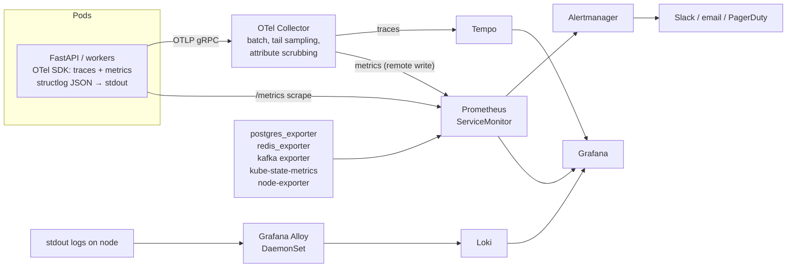

# 13 — Observability

> Covers prompt section 15.

---

## 1. Architecture



**Three signals, correlated:**
- Every log line carries `trace_id` and `span_id` → Grafana "Logs for this trace".
- Metrics carry **exemplars** (a `trace_id` attached to histogram samples) → click a latency spike → open the exact slow trace.
- Traces link to logs via `trace_id` (Tempo → Loki data link).

**Correlation is the point.** Three separate tools without links is "monitoring", not observability.

---

## 2. Instrumentation

### 2.1 Tracing (OpenTelemetry)

```python
# shared/infrastructure/telemetry.py
def setup_telemetry(app: FastAPI | None, service_name: str):
    resource = Resource.create({"service.name": service_name,
                                "service.version": settings.app_version,
                                "deployment.environment": settings.app_env})
    provider = TracerProvider(resource=resource, sampler=ParentBased(TraceIdRatioBased(settings.trace_sample_ratio)))
    provider.add_span_processor(BatchSpanProcessor(OTLPSpanExporter()))
    trace.set_tracer_provider(provider)

    if app:
        FastAPIInstrumentor.instrument_app(app, excluded_urls="healthz,metrics")
    SQLAlchemyInstrumentor().instrument(engine=engine.sync_engine, enable_commenter=True)  # sqlcommenter: trace id in SQL comments → pg_stat_statements correlation
    RedisInstrumentor().instrument()
    HTTPXClientInstrumentor().instrument()          # OSRM, PSP calls
    # Kafka: confluent-kafka instrumentation, or inject/extract traceparent manually (doc 09 §3)
```

**Custom spans that matter** (auto-instrumentation alone won't tell the business story):
`match_batch`, `phase1_geo_filter`, `phase3_insertion`, `osrm.table`, `fare.allocate`,
`outbox.publish`, `saga.proposal.resolve`. Attributes: `ride.id`, `trip.id`, `city`, `region`,
`batch.size`, `candidates.count`, `algorithm`.

**Sampling:** head-sample 10% in prod. Tail-sample in the Collector to **keep 100% of errors
and slow traces** (> 1 s) and 5% of the rest. Tail sampling is the right default; head-only
sampling throws away exactly the traces you need.

### 2.2 Metrics (Prometheus naming conventions)

**RED for every service** (Rate, Errors, Duration) and **USE for every resource**
(Utilization, Saturation, Errors).

| Metric | Type | Labels | Notes |
|---|---|---|---|
| `http_server_request_duration_seconds` | histogram | `method`, `route` (template, not raw path!), `status_class` | OTel semantic convention |
| `ride_match_latency_seconds` | histogram | `product`, `city`, `outcome` | `ride-requested` occurred_at → `ride-matched` |
| `ride_match_attempts_total` | counter | `product`, `city`, `outcome` = matched / no_drivers / cancelled / timeout | Success rate = matched / all |
| `pool_match_rate` | derived (recording rule) | `city` | matched pool rides with ≥ 2 riders / pool requests |
| `pool_added_duration_seconds` | histogram | `city` | Detour experienced. A product quality metric. |
| `match_batch_size` | histogram | `region` | |
| `match_commit_conflicts_total` | counter | `reason` = version / capacity | Optimistic-lock contention |
| `fare_calculation_total` | counter | `algorithm`, `result` = ok / error / ir_violation | |
| `fare_calculation_errors_total` | counter | `algorithm`, `error_type` | |
| `fare_allocation_delta_minor` | histogram | `algorithm` | Shadow algorithm vs. charged fare |
| `outbox_lag_seconds` | gauge | — | now − oldest unpublished `created_at` |
| `outbox_published_total` | counter | `topic` | |
| `kafka_consumer_lag` | gauge | `group`, `topic`, `partition` | From kafka-exporter / Strimzi |
| `consumer_processing_seconds` | histogram | `group`, `topic` | |
| `dlq_messages_total` | counter | `topic`, `reason` | Alert on any increase |
| `db_query_duration_seconds` | histogram | `operation`, `table` | From SQLAlchemy events; plus `pg_stat_statements` |
| `db_pool_checked_out` / `db_pool_wait_seconds` | gauge / histogram | `pool` | Pool saturation, a classic hidden bottleneck |
| `redis_command_duration_seconds` | histogram | `command` | |
| `osrm_request_duration_seconds` | histogram | `service` = route / table | |
| `circuit_breaker_state` | gauge | `dependency` | 0 closed, 1 half-open, 2 open |
| `driver_locations_ingested_total` / `_rejected_total` | counter | `reason` | GPS sanity rejections |
| `websocket_connections` | gauge | `role` | |
| `drivers_available` | gauge | `city` | Supply |
| `rides_waiting` | gauge | `city`, `product` | Demand backlog |

**Cardinality discipline:** never use `ride_id`, `user_id`, or raw URLs as labels. That
explodes Prometheus memory. High-cardinality detail belongs in **traces and logs**; metrics
are for aggregates. This is the most common observability failure in production.

### 2.3 Logs (structured JSON via structlog → stdout → Alloy → Loki)

```json
{"ts":"2026-11-13T10:15:02.124Z","level":"info","service":"api","env":"prod",
 "event":"ride.requested","ride_id":"01933c41-...","rider_id":"01933c3e-...","product":"POOL",
 "city":"HYD","trace_id":"4bf92f3577b34da6a3ce929d0e0e4736","span_id":"00f067aa0ba902b7",
 "request_id":"req_01933c3e9f","duration_ms":38}
```

- **Loki labels** (indexed, low-cardinality): `namespace`, `app`, `level`, `env`. Everything else is JSON fields, queried with `| json | ride_id="..."`.
- **Never log:** passwords, tokens, full card data, OTPs, precise rider home addresses. Add a structlog processor that scrubs known keys, plus a CI test that greps for violations.
- Log *events* (named, past tense), not sentences. `event="ride.requested"` is queryable; `"Ride was requested by user"` is not.
- Retention: 14 days hot in Loki; longer only for audit logs (stored in Postgres or object storage).

---

## 3. Dashboards (Grafana, provisioned as JSON in Git)

| Dashboard | Panels |
|---|---|
| **1. Service overview (RED)** | RPS, error %, p50/p95/p99 by route; SLO burn gauges; deploy annotations |
| **2. Marketplace / business** | Requests/min by product; **match success rate**; **pool match rate**; p95 match latency; drivers available vs. riders waiting per city (supply/demand); average detour; cancellation rate; surge heatmap (Geomap panel) |
| **3. Matching internals** | Batch size; phase durations (stacked); candidates per phase (funnel); commit conflicts; OSRM latency and cache hit ratio |
| **4. Pricing** | Fare calc rate and errors; IR violations (must be 0); shadow-algorithm deltas; revenue per trip by product |
| **5. Event pipeline** | Outbox lag; publish rate per topic; consumer lag per group/partition; DLQ count; retry-topic volume |
| **6. Data stores** | Postgres: TPS, connections, pool wait, top queries (pg_stat_statements), replication lag, cache hit ratio, dead tuples. Redis: ops/s, memory, hit ratio, evictions. Kafka: under-replicated partitions, ISR shrinks. |
| **7. Kubernetes** | Pod restarts, CPU throttling, memory vs. limit, HPA replicas vs. target, pending pods |

---

## 4. SLIs and SLOs

**SLI** = a measured ratio of good events / valid events. **SLO** = target for an SLI over a window.
**Error budget** = 1 − SLO. Window: 28 days, rolling.

| # | SLI | Good event definition | SLO |
|---|---|---|---|
| 1 | **API availability** | HTTP requests to `/v1/*` (excluding 4xx other than 429) that return non-5xx | **99.9%** |
| 2 | **API latency** | Sync API requests completed in < 200 ms | **99%** (p99 < 200 ms) |
| 3 | **Ride match latency** | Solo `ride-requested` → `ride-matched` in < 2 s | **95%** |
| 4 | **Match success** | Ride requests that reach `DRIVER_ASSIGNED` before rider cancel or timeout (excluding rider cancels < 10 s) | **90%** (business SLO; alerting is product-owned) |
| 5 | **Fare correctness** | Completed rides with a fare calculated without error and within IR (≤ quote) | **99.99%** |
| 6 | **Fare timeliness** | `ride-completed` → `fare-calculated` in < 60 s | **99.5%** |
| 7 | **Event freshness** | Kafka consumer lag for critical groups < 30 s | **99.5%** of minutes |
| 8 | **Location freshness** | Online drivers whose latest Redis position is < 10 s old | **99%** |
| 9 | **DB query time** | Primary-DB queries completing < 50 ms | **99%** (internal SLO, supports #2) |

### Recording rules (examples)

```yaml
groups:
  - name: slo-recording
    rules:
      - record: sli:api_availability:ratio_rate5m
        expr: |
          sum(rate(http_server_request_duration_seconds_count{route=~"/v1/.*",status_class!="5xx"}[5m]))
          /
          sum(rate(http_server_request_duration_seconds_count{route=~"/v1/.*"}[5m]))
      - record: sli:match_latency_good:ratio_rate5m
        expr: |
          sum(rate(ride_match_latency_seconds_bucket{product="SOLO",outcome="matched",le="2"}[5m]))
          /
          sum(rate(ride_match_latency_seconds_count{product="SOLO",outcome="matched"}[5m]))
      - record: pool_match_rate:ratio_rate15m
        expr: |
          sum by (city) (rate(ride_match_attempts_total{product="POOL",outcome="matched_shared"}[15m]))
          /
          sum by (city) (rate(ride_match_attempts_total{product="POOL"}[15m]))
```

### Multi-window, multi-burn-rate alerting (Google SRE workbook)

Alert on **how fast the error budget is burning**, not on raw thresholds:

```yaml
  - name: slo-alerts
    rules:
      - alert: APIAvailabilityFastBurn          # 2% of monthly budget in 1 h → page
        expr: |
          (1 - sli:api_availability:ratio_rate1h) > (14.4 * 0.001)
          and
          (1 - sli:api_availability:ratio_rate5m) > (14.4 * 0.001)
        labels: { severity: page }
        annotations:
          summary: "API burning error budget 14x"
          runbook_url: https://github.com/OWNER/ride-share/blob/main/docs/runbooks/api-availability.md
      - alert: APIAvailabilitySlowBurn          # 10% of budget in 3 days → ticket
        expr: |
          (1 - sli:api_availability:ratio_rate6h) > (1 * 0.001)
          and
          (1 - sli:api_availability:ratio_rate30m) > (1 * 0.001)
        labels: { severity: ticket }
      - alert: DLQNotEmpty
        expr: increase(dlq_messages_total[10m]) > 0
        labels: { severity: ticket }
      - alert: OutboxStuck
        expr: outbox_lag_seconds > 60
        for: 2m
        labels: { severity: page }
      - alert: FareIRViolation
        expr: increase(fare_calculation_total{result="ir_violation"}[5m]) > 0
        labels: { severity: page }            # we're overcharging someone
```

(The 1 h, 6 h, and 30 m ratio rules are defined the same way as the 5 m one.)

**Every alert has a runbook** (`docs/runbooks/*.md`): what it means, dashboards to open,
likely causes, mitigation steps. An alert without a runbook is a page that wakes you at 3 AM
with no next step.

---

## 5. Solo-dev simplifications

- Use **kube-prometheus-stack** (Helm) for Prometheus + Alertmanager + Grafana + exporters in one install. Add **Loki**, **Tempo**, and **Alloy** charts.
- Or start locally with **Grafana's `docker-otel-lgtm`** image (one container with Collector + Loki + Grafana + Tempo + Prometheus/Mimir), which is great for the docker-compose phase.
- Use **Sloth** or **Pyrra** to generate SLO recording and burn-rate rules from a short YAML spec, instead of hand-writing them.