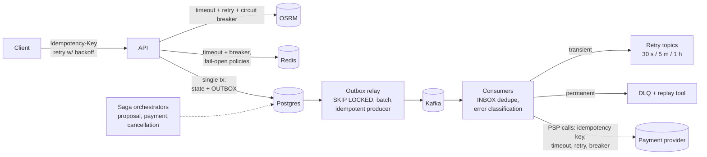
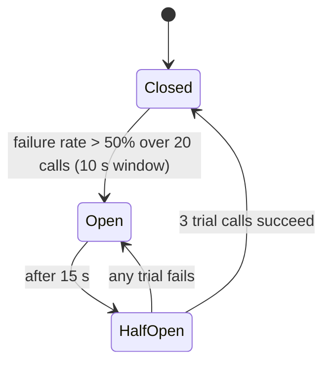

# 16 — Reliability Engineering

> Covers prompt section 19. For each pattern: what it is, **exactly where it lives in this
> system**, and how to implement it.

---

## 0. Reliability architecture at a glance



---

## 1. Retries

**What:** re-attempt an operation that failed for a *transient* reason.

**Rules:**
1. Retry only **idempotent** operations (or make them idempotent first; see §7).
2. Retry only **transient** errors: timeouts, connection resets, 502/503/504, 429 (honoring `Retry-After`), Postgres serialization failures (`40001`) and deadlocks (`40P01`). Never 400/401/403/404/409/422.
3. **Bound** retries by count *and* by total deadline.
4. **Retry at one layer only.** If the client, ingress, API, and HTTP library each retry 3×, one failure becomes 3⁴ = 81 calls (retry amplification). Pick the layer closest to the failure.

**Where in this system:**

| Call site | Policy | Owner layer |
|---|---|---|
| API → OSRM | 2 attempts, 150 ms per-attempt timeout, 400 ms total | `EtaService` adapter |
| API → Redis | 1 retry on connection error only; 200 ms timeout | Redis client wrapper |
| API → Postgres | Retry the **whole transaction** on `40001`/`40P01`, 3×; never retry after commit is ambiguous | Unit of work |
| Outbox relay → Kafka | librdkafka internal retries (idempotent producer) | Relay |
| Consumer handler | 3× in-process, then retry topics (doc 09 §5) | Consumer framework |
| Payments → PSP | 3× with the same idempotency key; then retry topic up to 1 h | Payment adapter |
| Mobile app → API | Retries with the same `Idempotency-Key` on network errors and 5xx | Client SDK |
| Ingress → pods | `proxy_next_upstream` **only** for connection errors on idempotent methods | ingress-nginx |

```python
# tenacity is already a dependency
from tenacity import retry, stop_after_attempt, stop_after_delay, wait_random_exponential, retry_if_exception_type

@retry(
    retry=retry_if_exception_type((httpx.ConnectError, httpx.ReadTimeout, UpstreamUnavailable)),
    wait=wait_random_exponential(multiplier=0.05, max=0.2),     # full jitter
    stop=(stop_after_attempt(2) | stop_after_delay(0.4)),
    reraise=True,
)
async def osrm_table(points: list[GeoPoint]) -> Matrix: ...
```

## 2. Exponential backoff with jitter

**Formula (full jitter, AWS Architecture Blog):** `sleep = random(0, min(cap, base × 2^attempt))`.

**Why jitter:** without it, 1,000 clients that failed at the same instant retry at the
same instants (synchronized waves) and re-DDoS the recovering dependency. Full jitter spreads
them uniformly.

**Where:** everywhere a retry exists (§1 table). Also in **reconnect loops**: the Kafka
consumer, the WebSocket client in the apps (critical: 30k reconnecting phones after a
gateway deploy is a self-inflicted DDoS), and Redis/DB pool reconnects.

## 3. Circuit breakers

**What:** after N failures in a window, stop calling the dependency for a cooldown (**open**),
then let a few trial calls through (**half-open**), and resume normally (**closed**) if they
succeed. It converts slow failure (timeouts piling up, threads/connections exhausted) into
fast failure with a **fallback**.



**Where, and the fallback for each (the fallback is the actual design work):**

| Dependency | Fallback when open |
|---|---|
| **OSRM** | Haversine × city detour factor (1.35) for quotes, with a flag `eta_quality=estimated`; matching uses wider safety margins on detour budgets; **Pool offering disabled** (can't guarantee detours without real ETAs) |
| **Redis** (geo index) | PostGIS KNN on `tracking.driver_locations` (slower, still correct) |
| **Redis** (surge) | Surge = 1.0 |
| **Redis** (rate limit) | In-process limiter (per pod, coarse) |
| **PSP** | Accept the ride (pre-auth deferred), queue the capture; mark the account `payment_pending`; block new rides after N unpaid |
| **Notification provider (FCM/SMS)** | WebSocket only; queue push for retry; drop expired notifications |
| **Postgres** | **No fallback**. Fail fast with 503 + `Retry-After`. Some things must not degrade. |

Implementation: `purgatory` or `aiobreaker` for asyncio, or a small hand-written breaker (≈ 60
lines; a good exercise). Export `circuit_breaker_state{dependency}` (doc 13). One breaker
instance per dependency **per pod**. A shared Redis-backed breaker is possible but couples
the breaker to Redis.

**Bulkheads** (companion pattern): separate connection pools / semaphores per dependency, so
a slow OSRM can't consume all the event loop's concurrency, e.g. `asyncio.Semaphore(50)`
around OSRM calls. Also: Kubernetes separates workloads into deployments (doc 03 §2.5), which is
a bulkhead at the infrastructure level.

**Timeouts** (prerequisite for everything above): every network call has one. Postgres
`statement_timeout = 2s` (app role), `idle_in_transaction_session_timeout = 10s`; httpx
timeouts explicit; Kafka `delivery.timeout.ms`. Timeout budgets shrink as you go deeper:
ingress 30 s > API handler 5 s > OSRM 400 ms.

## 4. Saga pattern

**What:** a long-running business transaction across multiple aggregates/services, built as a
sequence of local transactions, each with a **compensating action** for when a later step fails.

**Orchestration vs. choreography:**
- *Choreography:* services react to each other's events (no central coordinator). Good for simple linear flows (ride-completed → fare → payment → receipt). Hard to see the whole flow.
- *Orchestration:* a coordinator holds the saga's state machine and issues commands. Good for flows with branches, timeouts, and compensations. **Use it for the complex ones.**

**Sagas in this system:**

| Saga | Style | Steps | Compensations |
|---|---|---|---|
| **Ride completion → payment** | Choreography | `ride-completed` → Pricing computes fare → `fare-calculated` → Payments captures → `payment-completed` → Ride marks receipt ready | Capture fails permanently → mark `payment_failed`, retry with another method, notify rider, block future rides until resolved (no rollback of the ride: it happened) |
| **Pool proposal** (proposal mode) | **Orchestration** (Ride module) | Create proposal + lock rides → notify both → collect responses → on all-accept: commit trip insertion → dispatch driver | Decline/expiry/insert conflict → release locks, return rides to `MATCHING`, add exclusions, notify |
| **Driver dispatch** | Orchestration | Reserve driver (`SET NX`) → send offer → await accept (15 s) → assign | Timeout/decline → release reservation, exclude driver, re-dispatch; after N attempts → `NO_DRIVERS` + void pre-auth |
| **Pool cancellation mid-trip** | Orchestration | Cancel ride → remove stops from trip (version check) → re-route driver → re-price the remaining rider (only down) → cancellation fee for the canceller | Each step idempotent; failure → retry; never leave the trip with orphan stops (reconciler job as a backstop) |
| **Account deletion (DPDP)** | Orchestration | Anonymize identity → riders → rides (pseudonymize) → payments (retain per tax law) → tracking history purge | Retries; completion audited |

**Implementation:** a `sagas` table (`id, type, state, data jsonb, version, next_timeout_at`)
plus a step function `handle(saga, event) -> (new_state, commands)` (pure, unit-testable),
plus durable timers (`platform.scheduled_jobs`). Every command/event carries the `saga_id`
for idempotency and tracing.

**Industry comparison:** Uber built Cadence (now Temporal) precisely because hand-rolled sagas
become hard to maintain at scale. **Learning path:** hand-roll one saga (proposal), then rewrite it
with Temporal's Python SDK and compare (ADR: "Adopt Temporal for workflows?").

## 5. Transactional Outbox pattern

**Problem (dual write):**

```python
await session.commit()              # 1. DB committed
await kafka.send("ride-requested")  # 2. process crashes here → event LOST → ride stuck in MATCHING forever
```

Reversing the order is just as broken (event published, DB rollback → phantom ride).

**Solution:** write the event into an `outbox` table **in the same transaction** as the state
change. A separate relay publishes it.

```python
async with uow:                                       # one DB transaction
    ride = Ride.request(...)                          # aggregate raises RideRequested
    await uow.rides.add(ride)
    for e in ride.pull_events():
        await uow.outbox.add(to_integration_event(e)) # INSERT INTO platform.outbox
    await uow.commit()                                # atomic: both or neither
```

**Relay:**

```sql
-- run in a loop by outbox-relay (2 replicas; SKIP LOCKED makes them cooperate without leader election)
BEGIN;
SELECT id, event_id, topic, partition_key, payload, headers
FROM platform.outbox
WHERE published_at IS NULL
ORDER BY id
LIMIT 500
FOR UPDATE SKIP LOCKED;
-- produce all to Kafka (idempotent producer), flush, await delivery reports
UPDATE platform.outbox SET published_at = now() WHERE id = ANY(:published_ids);
COMMIT;
```

**Guarantees:** at-least-once (a crash between produce and UPDATE re-publishes → consumers
dedupe by `event_id`). **Ordering:** with two relays and SKIP LOCKED, two batches may publish
out of order. If per-key ordering matters (it does for `ride_id`), either run **one** active
relay (leader election via a Postgres advisory lock: `pg_try_advisory_lock(42)`), or shard
relays by `hash(partition_key) % N`. **Start with one leader-elected relay.**

**Alternative (production-grade):** **CDC with Debezium** reads the outbox table from the
Postgres WAL (logical replication) with the Outbox Event Router SMT. Lower latency, no
polling, strict commit order. More infrastructure (Kafka Connect). A great Phase 7 upgrade.

**Housekeeping:** partition `outbox` by day and drop old partitions, or delete published rows
older than 3 days in batches.

**Where:** every module that emits integration events (Ride, Pricing, Payments, Driver, Notifications).
**Not** location ingest: those events are disposable, high-volume, and have no DB transaction to pair with.

## 6. Dead Letter Queues

Covered in depth in doc 09 §5. Summary of **where**: one DLQ per (topic, consumer group) for
every consumer *except* `driver-location-updated`. Operational requirements:
- Alert on any DLQ growth (`DLQNotEmpty`).
- DLQ messages keep the original headers + failure metadata.
- A replay CLI with filters (by `ce_type`, time range, error) and a dry-run mode.
- A weekly DLQ review (in a team, part of on-call handoff).
- DLQ retention ≥ 14 days, longer than your longest vacation.

## 7. Idempotency

**The single most important reliability property in a distributed system,** because
at-least-once delivery + retries guarantee duplicates.

| Layer | Mechanism | Where |
|---|---|---|
| **HTTP API** | `Idempotency-Key` header → `platform.idempotency_keys` (user_id, key, request_hash, status, response). First request: insert `IN_PROGRESS`, execute, store response. Replay: return the stored response. Same key + different body → `409 IDEMPOTENCY_KEY_REUSED`. Concurrent duplicate while `IN_PROGRESS` → `409` + `Retry-After: 1`. Keys expire after 24 h. | `POST /rides`, `/cancel`, stop `complete`, proposal `accept/decline`, refunds, payment methods |
| **State machines** | Transitions are idempotent by design: `complete_stop` on an already-COMPLETED stop returns success without side effects. Transitions use conditional updates: `UPDATE … WHERE id = :id AND status = 'IN_PROGRESS'`. | Ride, Trip, Payment aggregates |
| **Kafka producer** | `enable.idempotence=true` (broker dedupes producer retries) | Relay, location ingest |
| **Kafka consumers** | **Inbox** table `processed_events(consumer_group, event_id)` inserted in the same tx as the handler's writes | All consumers with DB side effects |
| **Natural keys** | `UNIQUE(ride_id)` on fares; `UNIQUE(idempotency_key)` on payments; `UNIQUE(psp, psp_payment_id)` | Pricing, Payments |
| **External calls** | Pass an idempotency key to the PSP (`fare_id` + operation) so a retried capture never double-charges | Payments adapter |
| **Webhooks (inbound)** | Dedupe by the PSP's event id; verify the HMAC signature; process async | `/v1/webhooks/psp` |
| **Upserts** | Location "last known": `INSERT … ON CONFLICT (driver_id) DO UPDATE … WHERE excluded.recorded_at > driver_locations.recorded_at` (rejects out-of-order pings) | Tracking |

**Idempotency middleware sketch:**

```python
async def idempotent(request: Request, key: str, user_id: UUID, handler):
    body_hash = sha256(await request.body()).digest()
    row = await repo.try_insert_in_progress(user_id, key, body_hash)     # INSERT … ON CONFLICT DO NOTHING RETURNING
    if row is None:
        existing = await repo.get(user_id, key)
        if existing.request_hash != body_hash:
            raise Conflict("IDEMPOTENCY_KEY_REUSED")
        if existing.status == "IN_PROGRESS":
            raise Conflict("REQUEST_IN_PROGRESS", retry_after=1)
        return replay(existing.response_code, existing.response_body)
    response = await handler()
    await repo.complete(user_id, key, response.status_code, response.body)  # ideally in the SAME tx as the handler's writes
    return response
```

---

## 8. Other reliability mechanisms

| Mechanism | Where |
|---|---|
| **Graceful degradation / load shedding** | Under overload, shed in priority order: admin analytics → history → quotes → ride requests (protect the money path). Implement with priority-aware concurrency limits in middleware. |
| **Reconciliation jobs** (the safety net for everything above) | Hourly: rides stuck in `MATCHING` > 15 min → `NO_DRIVERS`; trips with no location for 5 min → alert/support; `ride-completed` without a fare after 10 min → re-emit; ledger Σ ≠ 0 → page. Every eventually-consistent system needs these. |
| **Health checks** | Readiness gates traffic; liveness is dependency-free (doc 08 §2.9) |
| **Graceful shutdown** | SIGTERM → stop accepting → drain in-flight → commit Kafka offsets → close pools (doc 11) |
| **Backpressure** | Bounded in-memory queues in the matcher and WS gateway; pause Kafka partitions when downstream is slow |
| **Disaster recovery** | PITR backups, tested restores, documented RTO/RPO (doc 17) |