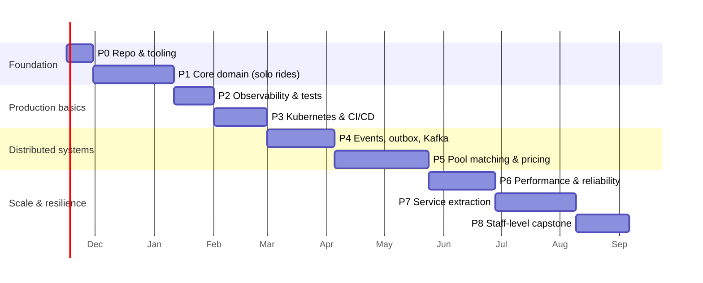

18-learning-roadmap.md
# 18 — Learning Roadmap: Junior → Staff

> Covers prompt section 21. Each phase produces something **demonstrable** and
> **measurable**, and ends with written artifacts (ADRs, reports). Writing is the Staff+
> skill that coding alone doesn't build.

Estimates assume ~10–15 h/week. The full roadmap is roughly 9–12 months. That's realistic
for this scope, so don't compress it by skipping the measurement steps.

---

## Phase 0: Foundations and repo restructure (1–2 weeks)

**Build**
- Keep the existing layered `src/` (`api/`, `controller/`, `services/`, `repositories/`, `models/`, `schemas/`, `utils/`) and add `clients/` and `workers/` (doc 03 §2.3–2.4). No restructure needed.
- Tooling: ruff (replace flake8 + isort), mypy strict on `services/`, pytest, pre-commit (currently empty), import-linter.
- docker-compose: PostGIS (already there), Redis, Kafka (KRaft, single node), OSRM with a small OSM extract, Grafana `otel-lgtm`.
- `pydantic-settings` config; `/healthz/live` and `/healthz/ready`; app factory.
- Write **ADR-0001: Layered monolith with enforced layer direction** and **ADR-0002: Ride/Trip split**.

**Concepts:** project structure, dependency direction, configuration management, ADRs, dev environment parity.
**Why it exists:** every later phase depends on clean boundaries. Retrofitting them is 10× harder.
**Skills:** codebase organization, tooling literacy, technical writing.

---

## Phase 1: Core domain: users, drivers, solo rides (5–6 weeks)

**Build**
- Identity: register/login, argon2id, JWT (ES256) + refresh rotation + reuse detection, RBAC + ownership checks.
- Drivers/vehicles: onboarding, approval, online/offline, with partial unique indexes.
- Tracking v1: location ingest → Postgres `driver_locations` (yes, deliberately the "naive" way first).
- Pricing v1: rate cards (versioned, EXCLUDE constraint), OSRM routes, quotes with expiry, `Money` value object.
- Rides v1: Ride + Trip aggregates with explicit state machines; request from quote; nearest-driver via PostGIS KNN; offer/accept/timeout (durable `scheduled_jobs`); stop arrive/complete; cancel with policy.
- Payments v1: fake PSP adapter; payment state machine; double-entry ledger.
- API: problem+json errors, idempotency keys, keyset pagination, OpenAPI quality.
- Alembic migrations with schemas per module.

**Concepts:** DDD aggregates and invariants, state machines, ACID transactions, isolation levels, constraint-driven design, REST semantics, authN/authZ, money handling.
**Why it exists:** this is the "senior backend engineer" core: correct software before distributed software.
**Skills:** data modeling, API design, transactional correctness, security fundamentals.
**Exit criteria:** a full solo ride works end-to-end via Swagger plus a scripted driver bot; one active ride per rider holds under a concurrent test.

---

## Phase 2: Testing and observability baked in (2–3 weeks)

**Build**
- The test pyramid (doc 15): Hypothesis properties for Money and pricing; testcontainers integration suite; authz matrix test; Schemathesis.
- OpenTelemetry tracing (FastAPI, SQLAlchemy, httpx, Redis) + custom spans; structlog JSON with trace ids; Prometheus metrics (RED + business); first Grafana dashboards.
- First **Locust** run at small scale against docker-compose → first performance report.

**Concepts:** test design, test doubles at ports, property-based testing, the three pillars + correlation, metric cardinality, RED/USE.
**Why it exists:** you can't safely evolve what you can't test, or operate what you can't see. Retrofitting either is painful.
**Skills:** quality engineering, instrumentation, measurement-driven debugging.

---

## Phase 3: Containers, Kubernetes, CI/CD (3–4 weeks)

**Build**
- Harden the Dockerfile (pin the Python version you can get wheels for; see doc 12 §1).
- kind cluster; Kustomize base + overlays; all manifests from doc 11 (probes, PDB, HPA, NetworkPolicies, security contexts); CloudNativePG; Redis; ingress + cert-manager (self-signed locally).
- GitHub Actions: `pr.yml`, `main.yml`, `deploy.yml` (doc 12) with an e2e job on kind.
- Same-image multi-deployment pattern (api, location-ingest, workers).
- Migration Job; expand/contract discipline; squawk.

**Concepts:** container image design, K8s scheduling and probes, rollout mechanics, zero-downtime deploys, supply-chain security, pipeline design, migration safety.
**Why it exists:** "it works on my machine" → "it deploys safely, repeatedly, and rolls back".
**Skills:** platform/DevOps fluency, which every Staff engineer needs in order to make credible infra decisions.
**Exit criteria:** a rolling deploy under Locust load produces 0 errors; a deliberately broken deploy auto-rolls back.

---

## Phase 4: Event-driven core: outbox, Kafka, Redis (4–5 weeks)

**Build**
- Transactional outbox + leader-elected relay; Kafka topics (Strimzi on K8s); event envelope with `traceparent`; JSON Schemas in `contracts/events/`.
- Consumers with inbox dedupe, error classification, retry topics, DLQ, and a replay CLI.
- Async request flow: `POST /rides` → 202 → matching worker consumes → WebSocket tracking gateway pushes updates.
- **Move the hot location path to Redis GEO**; benchmark it against Phase 1's PostGIS approach with Locust at 300 and 3,000 updates/s → **ADR-0005 with numbers**.
- Surge job (H3 cells → Redis); ETA cache; rate limiting via Redis.

**Concepts:** dual-write problem, delivery semantics, idempotency, partitioning and ordering, consumer groups and rebalancing, schema evolution, caching strategies and invalidation, eventual consistency UX.
**Why it exists:** this is the transition from "backend engineer" to "distributed systems engineer". Every hard problem from here on is a consequence of async messaging.
**Skills:** reasoning about failures between systems, which is the defining skill of senior-plus engineers.
**Exit criteria:** kill the relay, a consumer, and Redis during a load test. No lost rides, no duplicate fares, and recovery is automatic.

---

## Phase 5: Pool matching and fare allocation (the core domain) (6–7 weeks)

**Build**
- Matcher phases 1–6 (doc 06): H3 bucketing, corridor tests in PostGIS, insertion with slack times, batch windows, greedy assignment, optimistic commit with conflict retry.
- Proposal-mode saga with durable timers and compensation (behind a flag).
- All five fare allocation strategies with property tests; Algorithm 5 live, the others in **shadow mode**; driver pay engine; receipt line items.
- Brute-force oracle tests for the insertion planner.
- **Offline simulator**: synthetic demand over a city → compare greedy vs. Hungarian and window sizes on vehicle-km saved, match rate, and average detour → **report**.

**Concepts:** combinatorial optimization and heuristics, complexity analysis, geospatial indexing, concurrency control, saga orchestration, mechanism design and fairness, experimentation (shadow mode, flags).
**Why it exists:** Staff engineers own *core-domain* problems where the answer isn't in a tutorial: algorithmic, business-aware, and measured.
**Skills:** algorithm design under latency budgets, translating business goals into objective functions, evaluation methodology.
**Exit criteria:** two pool riders are matched end-to-end in e2e tests; the simulator report shows the algorithm's effect with numbers.

---

## Phase 6: Performance, reliability, SRE practices (4–5 weeks)

**Build**
- Medium-scale load tests (10k users) on a cloud cluster; find and fix bottlenecks (PgBouncer, outbox batching, partitioning, orjson); write ≥ 3 performance reports.
- Circuit breakers + fallbacks; bulkheads; load shedding; reconciliation jobs.
- SLOs with burn-rate alerts (Sloth/Pyrra); runbooks; Chaos Mesh experiments; a game day + practice postmortem.
- Backups + **timed restore drill**; DR doc.
- Security hardening pass: External Secrets, TLS in-cluster, PII encryption, ZAP scan.
- Production readiness checklist (doc 17) items [P2]: complete.

**Concepts:** capacity planning, bottleneck analysis (USE), queueing intuition (Little's law), failure modes, error budgets, incident management, DR, defense in depth.
**Why it exists:** systems in production are defined by how they fail. This phase builds operational judgment.
**Skills:** SRE mindset, quantitative decision-making, operational leadership.

---

## Phase 7: Microservice extraction (5–6 weeks)

**Build**
- Extract **Tracking** and **Matching** (doc 03 §3.2–3.3) using the strangler playbook: network seam → event-ified writes → separate deployment → data migration → delete from monolith.
- Schema Registry (Apicurio/Confluent) + Avro/Protobuf for location events; consumer-driven contract tests.
- Geo-sharded matching (partition by H3 region, KEDA on lag), with boundary handling.
- Optional: Debezium CDC outbox; Linkerd mTLS; Gateway API instead of Ingress.

**Concepts:** service boundaries and data ownership, contract versioning, migration without downtime, sharding and hot partitions, service mesh tradeoffs.
**Why it exists:** you'll feel the *cost* of microservices first-hand, which is what lets you argue against premature splits later (a very Staff thing to do).
**Skills:** large-scale refactoring, migration planning, evaluating architecture by cost and benefit.

---

## Phase 8: Staff-level capstone (3–4 weeks)

**Build / write**
- **Architecture review document** of your own system as it exists: what you'd change, the known risks, a 12-month evolution plan (multi-region? Temporal? ML ETAs?). Present it as if to a review board.
- **Large-scale stress test** (100k users) once, with a report on what broke first and why.
- Replace the hand-rolled proposal saga with **Temporal** and write a comparison ADR.
- Cost model: cost per 1,000 rides at each scale tier; the cheapest architecture that meets SLOs.
- A blog post/talk-style write-up of one deep topic (e.g. "Pool insertion with slack times" or "Why our outbox needed a leader").

**Concepts:** technical strategy, tradeoff communication, cost-aware architecture, influencing through writing.
**Why it exists:** Staff+ impact is mostly *decisions and alignment*, and those are delivered through documents.
**Skills:** technical leadership, strategic thinking, communication.

---

## Skill progression map

| Level | What you can do after… |
|---|---|
| **Junior → Mid** (P0–P2) | Build correct, tested, observable services with clean boundaries and solid data models. |
| **Mid → Senior** (P3–P4) | Ship safely to production, reason about async failures, design idempotent event-driven flows, make caching decisions with data. |
| **Senior → Staff** (P5–P8) | Own a core-domain algorithm end-to-end, run quantitative evaluations, design for failure and scale, lead migrations, and write the documents that drive decisions. |

## Solo-developer simplifications (what to skip without losing learning)

| Skip / simplify | Why it's safe |
|---|---|
| Real PSP integration | A fake with scriptable failures teaches more (the failure modes are the point). |
| Mobile apps | Python bots for riders and drivers + Swagger + a minimal admin page (HTMX or Streamlit). |
| Real OTP/SMS/push | Log-based fake notifier with the same interface. |
| Multi-region | Document it in the capstone; don't build it. |
| ML ETA / P(match) models | Lookup tables by H3 cell × hour; mention ML as future work. |
| Full Schema Registry until Phase 7 | JSON Schema files + contract tests cover the learning. |
| Managed cloud everything | kind for daily work; cloud only for load tests and the "real deploy" milestone (watch costs, tear down). |

## What not to simplify (the highest learning value per hour)

1. The **outbox + idempotent consumers** (Phase 4).
2. **Optimistic concurrency on the Trip aggregate** + the concurrent test (Phase 5).
3. **Insertion with slack times + the brute-force oracle test** (Phase 5).
4. **Load test reports with a hypothesis → measurement → change loop** (Phases 2, 4, 6).
5. **The restore drill** (Phase 6). Untested backups don't count as backups.
6. **ADRs for every major decision.** They're the habit that most distinguishes Staff engineers.